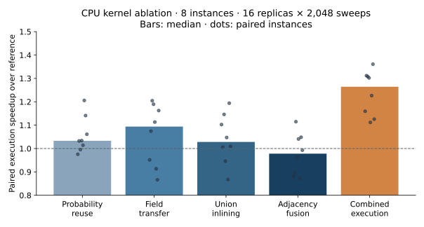

# Quip CPU Native

CPU-native optimization research and implementation for Quip Network's
structured proof-of-work solver. The project combines specialized CPU
execution, exact state reuse, and original-objective candidate preservation
within the standard Quip solver protocol.

**Start here** [CPU-native research log](docs/cpu-native/README.md)

The current implementation targets `quip/twisted-ice-dimer` revision 1 and
runs entirely on CPU. Its evaluated graph has **4,560 nodes and 41,205 edges**,
with weak magnitude 45 and 1,350 pairs. Search reweighting remains internal;
every emitted result is independently rescored against the canonical instance.

## Technical contributions

| Entry | Contribution | Implementation and purpose |
|---|---|---|
| [C01](docs/cpu-native/FINDINGS.md#c01) | Packed adjacency fusion | A 64-bit neighbor entry carries full and residual couplings, allowing cluster flips to patch fields and component deltas in one traversal. |
| [C02](docs/cpu-native/FINDINGS.md#c02) | Monotone union-find specialization | Inlined path halving and union operations preserve deterministic component numbering and random-draw order. |
| [C03](docs/cpu-native/FINDINGS.md#c03) | Shared transition probabilities | Temperature-local, collision-free tables reuse exact heat-bath and Metropolis probabilities across replicas. |
| [C04](docs/cpu-native/FINDINGS.md#c04) | Exact resampling state transfer | Reusable parent snapshots copy spins and local fields, replacing repeated adjacency reconstruction. |
| [C05](docs/cpu-native/FINDINGS.md#c05) | Original-objective candidate archive | Record candidates survive population ancestry replacement and receive canonical scoring and independent refinement. |
| [C06](docs/cpu-native/FINDINGS.md#c06) | Motif-domain energy conversion | Uniform weak couplings permit exact original-energy evaluation from tracked search energy and strong motifs. Full canonical rescoring remains the final proof check. |

The execution changes are independently selectable. Mechanical tests require
identical trajectories and energies relative to the reference implementation.
Search and candidate-selection changes are assessed separately at matched
budgets on the same canonical instances.

## Evidence and evaluation

The completed kernel ablation covers eight canonical instances and 40 paired
comparisons. The combined execution path achieved a **1.26× median speedup**
at 16 replicas and 2,048 sweeps, with identical candidate outputs in every pair.
The study alternates CPU assignments and retains each command and raw result.

At the operational **16 × 8,192 budget**, eight held-out instances confirmed
a **1.12× median execution speedup** with identical candidate outputs.
The original-objective archive improved two instances by 580 and 920 milli
units and preserved the best result on the others. Exact motif-domain scoring
then reduced archive pipeline time by **1.085×** in a separate paired study.
These are separate comparisons; their speedups are not multiplied.

A later opt-in build groups residual edges by endpoint and masks the
component-membership branch in the scan. In eight held-out full-pipeline
pairs, the observed median wall-time ratio was **1.028×** over the native path
with identical candidate outputs. The timing gain remains inconclusive.
[C38 timing evidence](docs/cpu-native/C30-C38-timing.md#c38-wall-time).

An opt-in lookup table for the four-spin tile patterns reached a **1.129× median
full-pipeline speedup** over that masked build. All eight paired runs returned
identical candidate spins and energies. [Finding C39](docs/cpu-native/FINDINGS.md#c39).

A later opt-in cluster build constructs membership during labeling and
keeps the full and residual local fields in one word. It reached a
**1.341× median speedup over C39** in eight balanced same-CPU pairs,
with identical outputs in every pair. The report includes the timing
control and direct comparison with the earlier native build.
[Finding C41](docs/cpu-native/FINDINGS.md#c41).



The [experiment report](docs/cpu-native/EXPERIMENTS.md) contains the complete
measurements, parameter studies, and evaluation scope. The [study runner](tools/cpu-native/run_study.py)
reproduces the comparisons offline without a node or signing key.

## Engineering documentation

- [Numbered findings and work log](docs/cpu-native/FINDINGS.md): implementation decisions, parameter experiments, protocol checks, and node observations, with stable entry numbers and evidence links.
- [Execution and algorithm design](docs/cpu-native/TECHNICAL_REPORT.md): equations, data layouts, state invariants, and the original-energy archive.
- [Experiments and raw evidence](docs/cpu-native/EXPERIMENTS.md): profiler-guided ablations, full-budget confirmation, and parameter studies.
- [Quip node and proof pipeline](docs/cpu-native/NODE_RESEARCH.md): nonce derivation, canonical instances, coordinator responsibilities, validation, and cancellation.
- [Live CPU operation](docs/cpu-native/LIVE_OPERATION.md): native deployment, coordinator-validated salt results, resource measurements, and qblock transition handling.
- [Build, configuration, and reproduction](docs/cpu-native/OPERATOR_GUIDE.md): installation, CPU settings, benchmark commands, and validation checks.

## Build

```sh
cargo build --release --locked --features experimental --bin quip-cpu-native --example cpu_native_bench -j 2
```

The toolchain is pinned to Rust 1.97.1. The Linux release includes the tested
binary, corresponding source, and checksums. The binary declares CPU hardware
and is supervised by the existing Quip coordinator.

## Validation

The validation suite covers scalar/native trajectory equality across execution
feature combinations, exact per-move energy changes, canonical generator
comparisons, original-energy conversion, archive non-regression, cancellation,
stale leases, deadlines, and balanced credit accounting. The repository includes
source and deterministic input data so these checks can be repeated.

## License and provenance

AGPL-3.0-or-later. [Source provenance](ACKNOWLEDGMENTS.md) identifies the base
framework and retained source components. The CPU-native contributions and
measured implementation changes are described above. The [base CPU backend
reference](docs/UPSTREAM_CPU_BACKENDS.md) is retained separately for compatibility.
