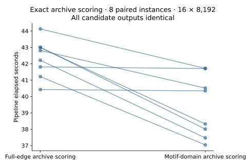
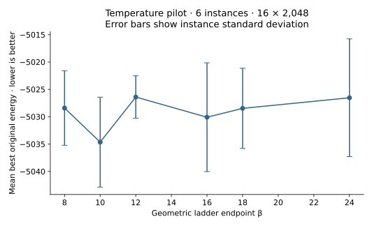

# CPU-native experimental evaluation

The CPU-native execution path improves throughput while preserving the
reference candidates. At 16 replicas × 8,192 sweeps, eight held-out instances
give a **1.122× median paired execution speedup**. A separate original-objective
archive preserves earlier useful states; exact motif scoring reduces its cost.
This report separates execution, candidate selection, and parameter experiments.

## Hardware, model, and measurement

| Item | Evaluated setting |
|---|---|
| CPU | AMD EPYC 7663 exposed as six x86_64 KVM vCPUs |
| Experiment placement | Two concurrent single-core benchmark processes, pinned to CPUs 3 and 4 at nice level 10 |
| Live miner allocation | CPUs 0 and 1, two lease workers, 1 GiB service memory cap |
| Toolchain | Rust 1.97.1, Cargo release profile, locked dependencies |
| Solver contract | quip-solver-core / protocol / conformance 0.0.15, solver protocol 2 |
| Family | `quip/twisted-ice-dimer`, revision 1 |
| Chain snapshot | Runtime spec 121, weak magnitude 45, 1,350 pairs |
| Canonical graph | 4,560 nodes, 41,205 edges |
| Search | Weak scale 1.5, integer weak magnitude 67; tile and pair auxiliary weights 250 milli |
| Population | 16 replicas; 512 configured resampling checkpoints; checkpoint Houdayer moves |
| Temperature | Geometric β=1 to β=12, unless a study explicitly varies the endpoint |
| Final polish | Original coefficients, greedy descent, β=20 for 256 cluster-plus-Metropolis sweeps on up to four regular candidates, final greedy descent; archive candidate refined separately |

The topology hash is
`0x2d130ce6df0fceacff26b90a06811829707bde8227d45e04ef71c804a8a5345c`.
[Topology](../../tools/cpu-funnel/inputs/current-topology.spec.json) and
[family descriptor bytes](../../tools/cpu-funnel/inputs/current-family.params)
are committed with the harness. Each offline nonce is `BLAKE3(seed.to_le_bytes())`;
the canonical generator constructs the instance from that nonce. The RNG seed
is the instance seed XOR `0x43505542454e4348`. No network submission is involved.

Kernel timing begins after instance generation and prepared-graph construction.
Pipeline timing begins at solver orchestration and includes graph preparation,
annealing, candidate handling, polishing, and canonical rescoring. Process
startup and canonical instance generation are outside both timers. Paired ratios
divide reference elapsed time by variant elapsed time. The two CPU assignments
alternate by instance. Times therefore measure the reported offline workload,
not the explorer's self-reported `device_access_time_us` field.

Energy tables use **energy units**, equal to `energy_milli / 1000`; lower is
better. Integer differences labeled milli units are reported without conversion.
All output energies include the canonical family offset.

## Profile-guided execution study

The baseline profile collected 3,215 user-space cycle samples with no lost
samples. The [aggregate profile](data/baseline-profile.txt) attributes approximately
66.5% to cluster sweeps, 14.8% to union-find joins, 9.1% to Metropolis sweeps,
3.14% to field reset, and 1.85% to `exp`. This identifies field movement and
component construction as substantial CPU costs; it does not establish the
speedup of any proposed optimization by itself.

The [ablation data](data/ablation-study/results.json) cover seeds 1001–1008,
16 replicas × 2,048 sweeps, and five independently selected variants. Each
variant is paired with a fresh scalar-reference run on the same instance:
**40 pairs / 80 runs**.

| Execution setting | Median paired speedup | Observed pair range | Output matches |
|---|---:|---:|---:|
| Shared probability table | 1.033× | 0.976–1.206× | 8/8 |
| Parent spin and field transfer | 1.094× | 0.866–1.205× | 8/8 |
| Inlined monotone union-find | 1.028× | 0.867–1.194× | 8/8 |
| Packed adjacency fusion | 0.978× | 0.872–1.115× | 8/8 |
| All four execution options | **1.264×** | 1.112–1.361× | **8/8** |


Fusion alone has a small median slowdown in this study. The combined path
improves every paired run. The options interact through cache occupancy,
memory traffic, and hot-loop layout, so their independent ratios are not
additive or multiplicative. The release configuration is supported by the
combined comparison and the full-budget confirmation below.

Operation counters corroborate what the code changes. At this budget, field
transfer reduces field rebuilds from 8,192 to 16 and performs 8,176 exact parent
field copies, avoiding 673,784,160 coefficient visits. The shared probability
arrays consume 294,936 bytes at the default capacity. In seed 1008's combined
run, counters record 26,311,626 heat-bath hits and 145,721,441 Metropolis hits,
with explicit misses and fallbacks retained in the raw record.

The harness field `trajectory_digest` hashes **returned candidate spins and
their original energies in order**. Equality proves exact output agreement
for the benchmark; per-sweep spin and energy equivalence is established by
the mechanical tests described below.

## Full-budget held-out confirmation

The [confirmation data](data/confirmation/results.json) use seeds 1021–1028,
which were excluded from the temperature pilot, at **16 × 8,192**. The scalar
reference uses the same population schedule, canonical instance, weak bias,
and polishing procedure with the four native execution options disabled.
Native execution enables those four options. The archive setting additionally
retains original-objective record states. This experiment preceded motif-domain
scoring and uses full-edge archive evaluation.

| Setting | Mean elapsed time | Mean best original energy | Best observed energy |
|---|---:|---:|---:|
| Scalar reference, β=12 | 43.649 s | −5048.9200 | −5059.455 |
| Native execution, β=12 | 39.293 s | −5048.9200 | −5059.455 |
| Native execution + archive, β=12 | 40.297 s | **−5049.1075** | −5059.455 |
| Native execution + archive, β=10 | 39.511 s | −5045.4613 | −5051.115 |

The median reference/native execution ratio is **1.122221×**, with a paired
bootstrap 95% median interval of **1.103708–1.140505×**. Candidate output digests
match in all eight pairs. The [summary](data/confirmation/summary.json) retains
the unrounded numbers. The bootstrap resamples instance ratios; it describes
this instance set and environment rather than performance across CPU models.


The archive improves seeds 1022 and 1027 by **580 and 920 milli units**
(0.580 and 0.920 energy units), respectively. It preserves the reference best
on the other six instances. Mean improvement is 187.5 milli units. The regular
path receives its original random sequence before the independent archive
candidate is polished, supporting the tested best-candidate non-regression
invariant. Archive preservation is an additional candidate-handling stage,
so its timing and quality are reported separately from execution-only speedup.

## Exact motif-domain archive scoring

For uniform weak magnitudes, the search energy and physical strong motifs
determine original energy exactly. The conversion replaces repeated full-edge
archive scans while leaving final canonical proof scoring intact. See the
[derivation and fallback guards](TECHNICAL_REPORT.md#motif-domain-original-energy-conversion).

The [motif comparison](data/motif-confirmation/results.json) contains eight
paired full-pipeline runs at 16 × 8,192 on seeds 1021–1028. It compares the
frozen full-edge-scoring benchmark with the motif implementation, alternating
CPU assignments.

| Archive scorer | Mean pipeline elapsed time | Output matches |
|---|---:|---:|
| Full original edge scan | 42.321 s | 8/8 |
| Exact motif-domain conversion | **39.388 s** | **8/8** |

The median paired ratio is **1.085200×**. The timing is for the complete
archive-enabled pipeline, not an isolated scorer microbenchmark. All returned
candidate digests match. The [build record](data/confirmation/build.json)
identifies the frozen pre-conversion executable by SHA-256. The public runner
reproduces the comparison using one current executable with the motif option
enabled or disabled; a final parity smoke run verifies that switch.



This experiment occurred separately from execution confirmation. Its mean
times are not paired with the earlier scalar-reference times, and the two
reported speedups are not multiplied into a combined claim.

## Temperature selection and confirmation

The [temperature pilot](data/temperature-study/results.json) tests β endpoints
8, 10, 12, 16, 18, and 24 on six instances, seeds 1011–1016, at 16 × 2,048.
Every run uses native execution with the archive disabled and polish β=20.

| Endpoint β | Mean best original energy | Mean elapsed time |
|---:|---:|---:|
| 8 | −5028.4133 | 11.255 s |
| 10 | **−5034.6467** | 10.587 s |
| 12 | −5026.4033 | 10.088 s |
| 16 | −5030.0967 | 9.892 s |
| 18 | −5028.4700 | 9.941 s |
| 24 | −5026.5333 | 9.175 s |



The pilot suggested β=10, but the held-out full-budget archive runs gave
mean energy −5045.4613 at β=10 versus −5049.1075 at β=12. The release therefore
retains **β=12 and polish β=20**. Changing sweep budget and archive handling
changes the operating regime; the pilot establishes a candidate setting and
the confirmation decides whether to deploy it.

An additional [two-instance colder pilot](data/thermal-pilot/results.json)
tested endpoints 48 and 64, with polish β=20 or 80. Those settings produced
shallower mean energies than the β=12 / polish β=20 reference on that small
set. The parameters remain available for future recipe-specific experiments.

## Correctness and protocol checks

The release validation checks the actual native binary and its family adapter:

- All 15 nonempty combinations of the four execution options are compared
  with scalar population outputs across seeds, schedules, and bond weights.
- Move-level tests compare cluster and Metropolis spin states and exact
  energy changes with the scalar path; tiny-model tests independently score
  every state and check cluster transition distributions.
- Canonical family generation and full original-energy scoring are compared
  with the contract generator, including random-state motif conversions at
  multiple weak bias scales and scalar/motif archive output equality.
- Archive non-regression, malformed descriptors, cancellation during sampling,
  expired deadlines, stale leases, digest mismatches, and balanced credit
  accounting are covered by the family library and session conformance suites.
- Formatting and Clippy checks complete with warnings denied for the changed
  library, native binary, benchmark example, and integration tests.

The [operator guide](OPERATOR_GUIDE.md#checks-and-operation) provides standard
Cargo commands. The final test logs and command records are in `data/validation/`.
Native deployment observations are recorded separately in
[live operation](LIVE_OPERATION.md); coordinator candidate validation is a
different event from inclusion of a winning proof in a block.

## Reproduction and evaluation scope

Build the locked release example and run the [portable study runner](../../tools/cpu-native/run_study.py):

```sh
cargo build --release --locked --features experimental --bin quip-cpu-native --example cpu_native_bench -j 2
python3 tools/cpu-native/run_study.py --suite ablation --cpus 3 4 --output /tmp/quip-ablation
python3 tools/cpu-native/run_study.py --suite confirmation --cpus 3 4 --output /tmp/quip-confirmation
python3 tools/cpu-native/run_study.py --suite motif --cpus 3 4 --output /tmp/quip-motif
python3 tools/cpu-native/run_study.py --suite temperature --cpus 3 4 --output /tmp/quip-temperature
```

Choose CPU IDs available on the evaluation host. The runner records source,
executable and input hashes, placement, full commands, original energies,
candidate digests, individual results, and paired summaries. Historical raw
commands preserve the original VPS paths; the public runner resolves paths
relative to its checkout. Kernel and pipeline budgets remain independently
selectable. `--disable-motif-score` reproduces scalar archive evaluation.

The evidence covers the specified Quip family, recipe, toolchain, and VPS.
It establishes exact CPU execution improvements and measured candidate
preservation on these instances. Validation against other recipes, bare-metal
CPUs, hardware architectures, or equal wall-time solver budgets requires its
own measurements. Network difficulty and competing proof sets vary by round;
the offline energy and timing comparisons do not determine a block-win rate.
