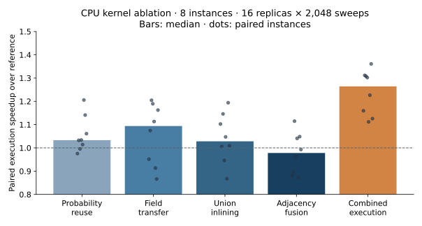

# CPU-native experimental evaluation

The CPU-native execution path improves throughput while preserving the
reference candidates. At 16 replicas × 8,192 sweeps, eight held-out instances
give a **1.122× median paired execution speedup**. A separate original-objective
archive preserves earlier useful states; exact motif scoring reduces its cost.
This report separates execution, candidate selection, and parameter experiments.

The [numbered findings log](FINDINGS.md) gives each implementation change,
operating decision, and source investigation a stable reference. This report
retains the full measurement setup and study tables.

## Hardware, model, and measurement

| Item | Evaluated setting |
|---|---|
| CPU | AMD EPYC 7663 exposed as six x86_64 KVM vCPUs |
| Experiment placement | Two concurrent single-core benchmark processes, pinned to CPUs 3 and 4 at nice level 10 |
| Live miner allocation | CPUs 0 and 1, two lease workers, 1 GiB service memory cap |
| Toolchain | Rust 1.97.1, Cargo release profile, locked dependencies |
| Solver contract | quip-solver-core / protocol / conformance 0.0.15, solver protocol 2 |
| Family | `quip/twisted-ice-dimer`, revision 1 |
| Chain snapshot | Runtime spec 121, weak magnitude 45, 1,350 pairs |
| Canonical graph | 4,560 nodes, 41,205 edges |
| Search | Weak scale 1.5, integer weak magnitude 67; tile and pair auxiliary weights 250 milli |
| Population | 16 replicas; 512 configured resampling checkpoints; checkpoint Houdayer moves |
| Temperature | Geometric β=1 to β=12, unless a study explicitly varies the endpoint |
| Final polish | Original coefficients, greedy descent, β=20 for 256 cluster-plus-Metropolis sweeps on up to four regular candidates, final greedy descent; archive candidate refined separately |

The topology hash is
`0x2d130ce6df0fceacff26b90a06811829707bde8227d45e04ef71c804a8a5345c`.
[Topology](../../tools/cpu-funnel/inputs/current-topology.spec.json) and
[family descriptor bytes](../../tools/cpu-funnel/inputs/current-family.params)
are committed with the harness. Each offline nonce is `BLAKE3(seed.to_le_bytes())`;
the canonical generator constructs the instance from that nonce. The RNG seed
is the instance seed XOR `0x43505542454e4348`. No network submission is involved.

Kernel timing begins after instance generation and prepared-graph construction.
Pipeline timing begins at solver orchestration and includes graph preparation,
annealing, candidate handling, polishing, and canonical rescoring. Process
startup and canonical instance generation are outside both timers. Paired ratios
divide reference elapsed time by variant elapsed time. The two CPU assignments
alternate by instance. Times therefore measure the reported offline workload,
not the explorer's self-reported `device_access_time_us` field.

Energy tables use **energy units**, equal to `energy_milli / 1000`; lower is
better. Integer differences labeled milli units are reported without conversion.
All output energies include the canonical family offset.

## Profile-guided execution study

The baseline profile collected 3,215 user-space cycle samples with no lost
samples. The [aggregate profile](data/baseline-profile.txt) attributes approximately
66.5% to cluster sweeps, 14.8% to union-find joins, 9.1% to Metropolis sweeps,
3.14% to field reset, and 1.85% to `exp`. This identifies field movement and
component construction as substantial CPU costs; it does not establish the
speedup of any proposed optimization by itself.

The [ablation data](data/ablation-study/results.json) cover seeds 1001–1008,
16 replicas × 2,048 sweeps, and five independently selected variants. Each
variant is paired with a fresh scalar-reference run on the same instance:
**40 pairs / 80 runs**.

| Execution setting | Median paired speedup | Observed pair range | Output matches |
|---|---:|---:|---:|
| Shared probability table | 1.033× | 0.976–1.206× | 8/8 |
| Parent spin and field transfer | 1.094× | 0.866–1.205× | 8/8 |
| Inlined monotone union-find | 1.028× | 0.867–1.194× | 8/8 |
| Packed adjacency fusion | 0.978× | 0.872–1.115× | 8/8 |
| All four execution options | **1.264×** | 1.112–1.361× | **8/8** |



Fusion alone has a small median slowdown in this study. The combined path
improves every paired run. The options interact through cache occupancy,
memory traffic, and hot-loop layout, so their independent ratios are not
additive or multiplicative. The release configuration is supported by the
combined comparison and the full-budget confirmation below.

Operation counters corroborate what the code changes. At this budget, field
transfer reduces field rebuilds from 8,192 to 16 and performs 8,176 exact parent
field copies, avoiding 673,784,160 coefficient visits. The shared probability
arrays consume 294,936 bytes at the default capacity. In seed 1008's combined
run, counters record 26,311,626 heat-bath hits and 145,721,441 Metropolis hits,
with explicit misses and fallbacks retained in the raw record.

The harness field `trajectory_digest` hashes **returned candidate spins and
their original energies in order**. Equality proves exact output agreement
for the benchmark; per-sweep spin and energy equivalence is established by
the mechanical tests described below.

## Full-budget held-out confirmation

The [confirmation data](data/confirmation/results.json) use seeds 1021–1028,
which were excluded from the temperature pilot, at **16 × 8,192**. The scalar
reference uses the same population schedule, canonical instance, weak bias,
and polishing procedure with the four native execution options disabled.
Native execution enables those four options. The archive setting additionally
retains original-objective record states. This experiment preceded motif-domain
scoring and uses full-edge archive evaluation.

| Setting | Mean elapsed time | Mean best original energy | Best observed energy |
|---|---:|---:|---:|
| Scalar reference, β=12 | 43.649 s | −5048.9200 | −5059.455 |
| Native execution, β=12 | 39.293 s | −5048.9200 | −5059.455 |
| Native execution + archive, β=12 | 40.297 s | **−5049.1075** | −5059.455 |
| Native execution + archive, β=10 | 39.511 s | −5045.4613 | −5051.115 |

The median reference/native execution ratio is **1.122221×**, with a paired
bootstrap 95% median interval of **1.103708–1.140505×**. Candidate output digests
match in all eight pairs. The [summary](data/confirmation/summary.json) retains
the unrounded numbers. The bootstrap resamples instance ratios; it describes
this instance set and environment rather than performance across CPU models.


The archive improves seeds 1022 and 1027 by **580 and 920 milli units**
(0.580 and 0.920 energy units), respectively. It preserves the reference best
on the other six instances. Mean improvement is 187.5 milli units. The regular
path receives its original random sequence before the independent archive
candidate is polished, supporting the tested best-candidate non-regression
invariant. Archive preservation is an additional candidate-handling stage,
so its timing and quality are reported separately from execution-only speedup.

## Exact motif-domain archive scoring

For uniform weak magnitudes, the search energy and physical strong motifs
determine original energy exactly. The conversion replaces repeated full-edge
archive scans while leaving final canonical proof scoring intact. See the
[derivation and fallback guards](TECHNICAL_REPORT.md#motif-domain-original-energy-conversion).

The [motif comparison](data/motif-confirmation/results.json) contains eight
paired full-pipeline runs at 16 × 8,192 on seeds 1021–1028. It compares the
frozen full-edge-scoring benchmark with the motif implementation, alternating
CPU assignments.

| Archive scorer | Mean pipeline elapsed time | Output matches |
|---|---:|---:|
| Full original edge scan | 42.321 s | 8/8 |
| Exact motif-domain conversion | **39.388 s** | **8/8** |

The median paired ratio is **1.085200×**. The timing is for the complete
archive-enabled pipeline, not an isolated scorer microbenchmark. All returned
candidate digests match. The [build record](data/confirmation/build.json)
identifies the frozen pre-conversion executable by SHA-256. The public runner
reproduces the comparison using one current executable with the motif option
enabled or disabled; a final parity smoke run verifies that switch.


This experiment occurred separately from execution confirmation. Its mean
times are not paired with the earlier scalar-reference times, and the two
reported speedups are not multiplied into a combined claim.

## Temperature selection and confirmation

The [temperature pilot](data/temperature-study/results.json) tests β endpoints
8, 10, 12, 16, 18, and 24 on six instances, seeds 1011–1016, at 16 × 2,048.
Every run uses native execution with the archive disabled and polish β=20.

| Endpoint β | Mean best original energy | Mean elapsed time |
|---:|---:|---:|
| 8 | −5028.4133 | 11.255 s |
| 10 | **−5034.6467** | 10.587 s |
| 12 | −5026.4033 | 10.088 s |
| 16 | −5030.0967 | 9.892 s |
| 18 | −5028.4700 | 9.941 s |
| 24 | −5026.5333 | 9.175 s |


The pilot suggested β=10, but the held-out full-budget archive runs gave
mean energy −5045.4613 at β=10 versus −5049.1075 at β=12. The release therefore
retains **β=12 and polish β=20**. Changing sweep budget and archive handling
changes the operating regime; the pilot establishes a candidate setting and
the confirmation decides whether to deploy it.

An additional [two-instance colder pilot](data/thermal-pilot/results.json)
tested endpoints 48 and 64, with polish β=20 or 80. Those settings produced
shallower mean energies than the β=12 / polish β=20 reference on that small
set. The parameters remain available for future recipe-specific experiments.

## Storage and resampling pilots

Five comparisons use the native kernel at 16 replicas × 2,048 sweeps on
seeds 1031–1038. Both processes use the `core` preset with an 8,192-slot cache.
CPU assignments alternate on cores 3 and 4. Each variant had a fresh reference
run for each seed. [Findings C31–C34](FINDINGS.md#c31).

| Candidate | Median speed ratio | Paired bootstrap 95% median interval | Matches |
|---|---:|---:|---:|
| [32-bit fields](data/storage-resampling/fields32/summary.json) | 0.964× | 0.927–1.019× | 8/8 |
| [16-bit cache stamps](data/storage-resampling/stamps16/summary.json) | 0.962× | 0.872–1.004× | 8/8 |
| [Selective resampling](data/storage-resampling/selective/summary.json) | 1.010× | 0.979–1.105× | 8/8 |
| [Both storage changes](data/storage-resampling/compact/summary.json) | 0.974× | 0.846–1.136× | 8/8 |
| [Both storage changes and selective resampling](data/storage-resampling/combined/summary.json) | 1.021× | 0.941–1.143× | 8/8 |

The two storage changes together saved 632,836 bytes across the live fields,
resampling snapshots, and probability arrays of one 16-replica solve. These
are allocated array payloads. Selective resampling reduces the copies made at
each checkpoint while retaining the same reserved snapshot capacity. The
pilot supports the payload and copy-count reductions. Its timing intervals
all span 1.0×.

The [source manifest](data/storage-resampling/source-sha256.json) records the
build inputs captured during the pilot. The listed files match commit
[`36519c0`](https://github.com/NSEVEjk0/quip-solver-cpu/commit/36519c0bedb029d82246336f9a151559a5eafccb).
The run metadata records the Git HEAD and working-tree status at measurement
time. Build feature flags and executable hashes identify each comparison.

## Cluster-boundary field updates

The candidate adds `cluster-boundary-updates` to the locked release build.
Each run uses the existing native execution options. The pilot times the
population kernel. The full-budget comparison includes graph preparation,
the original-energy archive, motif-domain scoring, and polishing.

| Comparison | Seeds | Replicas × sweeps | Mean reference / candidate | Median ratio | Paired bootstrap 95% median interval | Matches |
|---|---:|---:|---:|---:|---:|---:|
| [Kernel pilot](data/cluster-boundary/pilot-boundary/results.json) | 1041–1048 | 16 × 2,048 | 10.255 / 9.010 s | 1.129× | 1.069–1.147× | 8/8 |
| [Full pipeline](data/cluster-boundary/confirm-boundary/results.json) | 1051–1058 | 16 × 8,192 | 36.597 / 36.475 s | 0.996× | 0.976–1.088× | 8/8 |

In the pilot, 3.87–4.36% of the accepted-component adjacency visits were
interior edges. The candidate skips 3.18–3.55 million interior neighbor
patches per run and adds 5.45–5.59 million field transformations. Measured
full-pipeline performance is near parity, with exact output agreement.
The feature is off by default. [Derivation](TECHNICAL_REPORT.md#c35-cluster-boundary-field-updates),
[binary and source hashes](data/cluster-boundary/build.json).

## Packed component labels and spin signs

The `packed-component-spins` feature reuses the completed union-find buffer
to store a component ID and one sign bit per node. Both studies use the
`core` preset, 16 replicas × 2,048 sweeps, and the native comparison build
with ordinary field and stamp widths. Each pair returns the same candidate
spins and original energies.

| Comparison | Seeds | Median speed ratio | Paired bootstrap 95% median interval | Matches |
|---|---:|---:|---:|---:|
| [Initial kernel pilot](data/packed-component-spins/pilot-packed/results.json) | 1061–1068 | 1.124× | 0.826–1.231× | 8/8 |
| [Kernel with hardware counters](data/packed-component-spins/perf-packed/results.json) | 1071–1078 | 0.939× | 0.892–0.990× | 8/8 |

In the instrumented pairs, the median candidate retired 4.9% more
instructions and used 4.5% more process CPU time. Perf counts cover the
whole benchmark process, including preparation and verification outside
the harness timer. The total instruction count establishes an increase
for this build, without attributing it to individual operations.
[Counter summary](data/packed-component-spins/perf-packed/summary.json).

## Row-grouped residual energy scan

With `row-grouped-residual-deltas`, a lazy compressed adjacency stores each
residual edge once, from the lower endpoint. The scan uses one spin and
component lookup for the head of each row and one component-delta update for
its subtotal. Additions use 64-bit integers and retain the reference
component draw order. The row-grouped scan takes precedence if the two
residual layout features are built together.

| Comparison | Seeds | Replicas × sweeps | Median speed ratio | Paired bootstrap 95% median interval | Matches |
|---|---:|---:|---:|---:|---:|
| [Kernel](data/residual-edge-scan/pilot-row/results.json) | 1081–1088 | 16 × 2,048 | 1.066× | 0.885–1.228× | 8/8 |
| [Full pipeline](data/residual-edge-scan/confirm-row/results.json) | 1091–1098 | 16 × 8,192 | 0.997× | 0.900–1.036× | 8/8 |

In the full pipeline, the median changes in whole-process counters were
**−10.6% instructions, +20.0% branch misses, and +3.7% cycles**. The retired
instruction count fell on every seed. The elapsed-time interval spans parity,
so the feature remains experimental. [Full-pipeline counter summary](data/residual-edge-scan/confirm-row/summary.json).

### Mask the interior-edge term

The `masked-residual-deltas` build keeps the grouped layout and adds the
edge term after masking it by component membership. Same-component edges
add zero. This tests whether removing the branch helps even though the
loop performs arithmetic and a delta update for every edge.

The [kernel pilot](data/residual-edge-scan/pilot-masked/results.json) compares
the two row-grouped builds at 16 × 2,048 on seeds 1101–1108. All eight output
digests matched. The median speed ratio was 1.129×, with a paired bootstrap
95% median interval of 0.985–1.250×. The masked build recorded 41.1% fewer
branch misses and 6.8% fewer cycles, with 12.4% more retired instructions at
the median. [Counter summary](data/residual-edge-scan/pilot-masked/summary.json).

The [full-pipeline comparison](data/residual-edge-scan/confirm-masked/results.json)
uses the existing native build as the reference and the archive preset in both
arms. At 16 × 8,192 on seeds 1111–1118, mean elapsed time was 40.899 s for the
reference and 39.344 s for the masked build. The median speed ratio was
**1.028×**, with a paired bootstrap 95% median interval of **1.006–1.061×**.
Seven of eight pairs ran faster, and all eight candidate digests matched.

Whole-process median counts showed 28.8% fewer branch misses, 5.1% fewer cycles,
and 3.1% more retired instructions. Cycle and branch-miss counts fell in every
pair. The measurements cover the specified recipe and one EPYC 7663 VPS. The
masked path is an opt-in build. [Counter summary](data/residual-edge-scan/confirm-masked/summary.json),
[build and hashes](data/residual-edge-scan/masked-build.json).

The C38 wall-time ratio describes those eight pairs. A subsequent
same-binary control with C39 on the same VPS produced ratios from 0.952×
to 1.120×. [Control and measurement setup](#same-binary-timing-control).

## Table-driven tile bond sampling

In a profile of the C38 archive pipeline at 16 × 4,096, `Workspace::partition`
accounted for 41.2% of sampled user-space cycles. The function draws tile
and pair bonds and builds the component lists. [Profile settings](data/tile-bonds/build.json).

A four-bit mask records which spin signs match their tile gauges. A 16-entry
table gives the number of up spins and the ordered up and down positions.
Retaining the order preserves the partners selected by the low random bits
on ice tiles and by the two range draws on defect tiles. The sampler uses the
same probability thresholds and consumes random draws in the same order.

Both builds use Rust 1.97.1 and the same source revision with C38's masked
residual scan enabled. The candidate also enables `table-tile-bonds`. Each pair
runs on CPUs 3 and 4 of one AMD EPYC 7663 VPS, alternating CPU placement.
[Build flags and binary hashes](data/tile-bonds/build.json).

| Comparison | Seeds | Replicas × sweeps | Median speed ratio | Paired bootstrap 95% median interval | Faster pairs | Exact matches |
|---|---:|---:|---:|---:|---:|---:|
| [Kernel](data/tile-bonds/kernel/results.json) | 1129–1136 | 16 × 2,048 | 1.062× | 1.024–1.206× | 8/8 | 8/8 |
| [Archive pipeline](data/tile-bonds/pipeline/results.json) | 1141–1148 | 16 × 8,192 | **1.129×** | 1.041–1.165× | 8/8 | 8/8 |

In the full pipeline, mean solver time fell from 36.719 s to 32.900 s.
Whole-process median ratios correspond to 17.5% fewer branch misses, 5.9%
fewer cycles, and 0.4% more retired instructions. Branch misses and cycles
fell in every pair in both comparisons. [Pipeline summary](data/tile-bonds/pipeline/summary.json),
[kernel summary](data/tile-bonds/kernel/summary.json).

## Same-binary timing control

At the full archive budget of 16 replicas × 8,192 sweeps, eight pairs ran
the same C39 executable on this EPYC 7663 VPS. The wall-time ratios ranged
from 0.952× to 1.120×, with a median of 0.985×. Across the same pairs, CPU
cycle ratios ranged from 0.998× to 1.019×. The two processes alternated
between CPUs 3 and 4. [Raw control pairs](data/cluster-fields/control-c39/results.json).

## Component construction

The `shallow-union-roots` path tests whether the parent is already a root.
Roots and their immediate children finish at that check. Deeper paths still
use path halving. A union attaches the larger root to the smaller one, so a
component's root is still its smallest node.

With `linked-component-lists`, the pass that labels the nodes also builds
component membership. The root opens a list and later members prepend one
node at a time. This removes the separate count, prefix sum, and placement
passes. Components keep their heat-bath order. The accepted flips inside a
component can visit its members in reverse order because the integer field
patches add to the same final fields and the energy differences telescope.

The combined change reached 1.231× at the median in four kernel pilot
pairs. At the full archive budget on eight fresh instances it reached
**1.218×** over C39, with a paired bootstrap 95% median interval of 1.121–1.299×.
The component build won all eight full-budget pairs and returned identical
candidate spins and energies in all eight. The whole-process median showed
14.2% fewer cycles and 36.1% fewer branch misses.
[Pilot](data/cluster-fields/pilot-components/results.json),
[full-budget pairs](data/cluster-fields/full-components/results.json).

## Packed residual fields

The `packed-residual-fields` path stores the signed full local field in the
upper 32 bits and the residual field plus `2^31` in the lower 32 bits. Admitted
graphs have at most `2^21` nodes, distinct neighbors, zero fields, and
coupling magnitude at most 1,000 milli. Each local field therefore has
magnitude at most 2,097,151,000, which fits within signed 32 bits. Each move
keeps the biased residual field within its lane. A neighbor's complete
update multiplies `J_full * 2^32 + J_residual` by the signed spin change and
applies the result to both fields with one wrapping addition. The signed
coefficient fits in 43 bits alongside the 21-bit neighbor index.

At the heat-bath draw, the component gets its residual delta from the
current residual fields. For member `u`, the field term is
`-2 * s[u] * residual_field[u]`. An interior edge occurs twice in that sum,
so the solver adds back `4 * J_residual * s[u] * s[v]` once per interior edge.
Singletons get their delta directly from the field. A two-node component has
exactly one sampled bond and one edge between its members. The residual
energy is `tile_milli - 1000` for opposite gauged spins in a tile and
`pair_milli - 1000` for equal spins on a dimer. A graph-local pair lookup
identifies which constant to use. Larger components scan the forward
residual rows and mask the contribution from every exterior edge.

Each accepted move updates both fields for subsequent components. The packed
implementation uses its own fused field updates and takes precedence over
the compact local-field, cluster-boundary, and masked residual initialization
experiments when those build flags are combined.

### Pilot builds

| Candidate | Reference | 16-replica pilot | Median wall ratio | Median CPU cycle change | Exact matches |
|---|---|---|---:|---:|---:|
| [Initial packed fields](data/cluster-fields/pilot-packed/results.json) | C39 | Core kernel, 2,048 sweeps | 0.842× | +9.2% | 4/4 |
| [Initial packing with linked membership and shallow roots](data/cluster-fields/pilot-packed-linked-shallow/results.json) | C39 | Core kernel, 2,048 sweeps | 1.032× | −8.0% | 4/4 |
| [Packing with the two-spin shortcut and masked interior scan](data/cluster-fields/pilot-packed-pairs/results.json) | Component build | Archive pipeline, 2,048 sweeps | 1.145× | −14.0% | 4/4 |

The initial packed-only pilot recorded a dirty measurement checkout during
the benchmark harness edit. The executable was already built from the
revision and feature set recorded in the manifest.
[Build revisions and executable hashes](data/cluster-fields/build.json).

### Full-budget comparisons

The final build enables linked component lists, shallow roots, and packed
residual fields alongside the C39 tile lookup. Each comparison uses the
archive preset at 16 replicas × 8,192 sweeps on the same EPYC 7663 VPS.
The timer covers the complete offline solver call, including graph
preparation and archive polishing. Hardware counters cover the benchmark
process. Each pair has the same canonical instance and checks the ordered
candidate spins and original energies.

The side-by-side runs swap CPU assignments each pair. The sequential
retest runs both binaries on the same CPU within a pair. In each block
of four pairs, both CPUs run reference-first and candidate-first once.
Each comparison uses fresh canonical instances.

| Reference and run order | Seeds | Median speedup | Range across pairs | Paired bootstrap 95% median interval | Exact matches |
|---|---:|---:|---:|---:|---:|
| [C39, side by side](data/cluster-fields/full-final-c39/results.json) | 1221–1228 | **1.420×** | 1.182–1.511× | 1.346–1.480× | 8/8 |
| [C39, sequential on the same CPU](data/cluster-fields/serial-final-c39/results.json) | 1231–1238 | **1.341×** | 1.256–1.467× | 1.291–1.398× | 8/8 |
| [Earlier native build, side by side](data/cluster-fields/full-final-native/results.json) | 1241–1248 | **1.516×** | 1.332–1.720× | 1.418–1.674× | 8/8 |

The final build ran faster in all 24 pairs. Against C39 the whole-process
median cycle reduction was 27.5% side by side and 27.3% sequentially.
Retired instructions fell 22.4% at the median in the sequential comparison.
Against the earlier native reference the median cycle reduction was 35.5%.
[Side-by-side summary](data/cluster-fields/full-final-c39/summary.json),
[same-CPU summary](data/cluster-fields/serial-final-c39/summary.json),
[earlier-native summary](data/cluster-fields/full-final-native/summary.json).

## Integer cutoffs for transition draws

The trial encoded each probability `p` as `ceil(p * 2^53)`. This makes
comparing the original 53-bit random integer with the cutoff equivalent
to comparing its normalized value with `p`. The four archive pilot pairs
matched outputs and recorded a 0.948× median wall ratio against the
component build, with 1.5% fewer cycles at the median. The flag was retired
after the pilot. [Raw pilot results](data/cluster-fields/pilot-integer/results.json).

## Tree and cyclic polishing

The solver first completes the C41 population anneal, archive, and
regular polishing. Tree polishing then optimizes the original integer Ising
objective on the finished batch. A randomized partition starts from each
unassigned root and adds a node only while it has one nonzero edge to the
current group. Each induced tree consequently has exactly the parent edges
recorded when it was built.

For a node with spin `s[u]` and full local field `f[u]`, the cost of flipping
it alone is `-2*s[u]*f[u]`. If both endpoints of an internal edge flip, the
two field terms counted a change that cancels. Add `4*J*s[u]*s[v]` to the
joint cost. A bottom-up pass keeps two costs per node, one for each choice
its parent can make. A forward pass reconstructs the minimum, and the solver
applies it only when the total delta is negative. Updating the neighboring
fields makes the next tree conditional on the current spins.

Sixteen seeded partitions are reused for up to sixteen passes per candidate.
The eight lowest-energy reads are processed first. For up to four other
reads, the solver copies only the donor's energy-lowering disagreement
components and then runs tree descent again. Nonzero edges do not connect
different disagreement components, so the merge can choose the better
contribution independently. The benchmark verifies every output against the
canonical scorer.

The optional cyclic pass also enumerates all assignments of blocks with up
to eight spins. It starts from a tile or dimer and selects neighboring spins
by coupling magnitude. Its subset recurrence accounts for every internal
coupling, including cycles. The cyclic study compares the combined tree and
block polish with C41. Its contribution relative to trees alone is unmeasured.

### Full-budget candidate quality

Each pair used the archive preset, the same canonical instance, 16 replicas,
8,192 annealing sweeps, and 256 regular polishing sweeps. Both builds ran
sequentially on one CPU within each pair on a single EPYC 7663 VPS, balancing
which build went first. Best gain is reference minus candidate energy in
integer milli units. Positive gains indicate lower candidate energies.

| Candidate | Instances | Lower best energy | Ties | Higher | Median gain | Range | Median wall ratio |
|---|---|---:|---:|---:|---:|---:|---:|
| [Tree and recombination](data/tree-polish/full-tree/results.json) | 1341–1352 | 10/12 | 2 | 0 | 90 | 0 to 360 | 0.958× |
| [Tree and recombination, confirmation](data/tree-polish/confirm-tree/results.json) | 1371–1378 | 5/8 | 3 | 0 | 90 | 0 to 360 | 1.125× |
| [Tree, recombination, and cyclic blocks](data/tree-polish/full-cyclic/results.json) | 1421–1428 | 4/8 | 4 | 0 | 45 | 0 to 180 | 0.972× |

The two tree series lowered the best candidate energy on **15 of 20** fresh
instances and tied on five. The pooled median gain was **90 milli units**,
and the maximum was **360 milli units**. All ranks of the sorted 16-candidate
energy list tied or improved in every comparison above. Candidate spins can
change. The timing intervals span parity in all three series. The first tree
series showed 1.6% more CPU cycles and the repeat was within 0.1% of parity.
[First summary](data/tree-polish/full-tree/summary.json),
[repeat summary](data/tree-polish/confirm-tree/summary.json),
[cyclic summary](data/tree-polish/full-cyclic/summary.json).

Exhaustive tests compare tree and cyclic assignments with direct rescoring
on a six-spin cyclic graph. The recombination test compares all 4,096 parent
pairs. The final release checks exercise the opt-in canonical pipeline and
its native protocol. [Validation](data/tree-polish/validation-final-enabled.json).

### Smaller search budgets and restarts

The [matched-budget pilots](data/tree-polish/quality-equal-1271.json) tested
tree polishing with 256 and 32 regular polish sweeps. The shorter setting
regressed on three of four short runs, and matched the longer variant's best
gain on six exploratory full-budget runs.
[Full-budget pilots](data/tree-polish/quality-equal-1301.json).

Halving and quartering the annealing budget both worsened the best energy in
all four 4,096-sweep reference pairs. With tree polishing and the full 4,096
annealing sweeps, running Metropolis every two, four, or eight cluster sweeps
regressed on three, three, or two of four instances, respectively. Sixteen
collective restart attempts tied the existing tree build on four instances.
[Smaller budgets](data/tree-polish/quality-reduced-1281.json),
[cadence 2](data/tree-polish/pilot-cadence-2/results.json),
[cadence 4](data/tree-polish/pilot-cadence-4/results.json),
[cadence 8](data/tree-polish/pilot-cadence-8/results.json),
[restart](data/tree-polish/pilot-restart/results.json).

## Residual-scan and compiler trials after C41

A sampled C41 profile attributed 46.95% of user-space cycles to optimized
cluster sweeps, 32.76% to partitioning, and 13.68% to cached Metropolis
sweeps. The hottest annotated cluster loop was the interior-edge correction.
The following pilots use 16 replicas and 2,048 sweeps. They compare the same
candidate output digests, with the matching binary revisions and hashes in
the [build manifest](data/tree-polish/builds.json).

| Candidate | Pairs | Median wall ratio | Median CPU cycle change | Exact matches |
|---|---:|---:|---:|---:|
| [Motif-specific residual rows](data/tree-polish/pilot-motif/results.json) | 4 | 0.803× | +18.4% | 4/4 |
| [Explicit induced-edge lists](data/tree-polish/pilot-interior/results.json) | 4 | 0.690× | +42.7% | 4/4 |
| [16-bit field-link dictionary](data/tree-polish/pilot-dictionary/results.json) | 4 | 1.204× | -0.3% | 4/4 |
| [AVX2 residual gathers](data/tree-polish/pilot-avx2/results.json) | 4 | 1.056× | -5.5% | 4/4 |
| [Byte membership](data/tree-polish/pilot-byte/results.json) | 4 | 1.008× | +11.6% | 4/4 |
| [Signed population-count groups](data/tree-polish/pilot-bitmask/results.json) | 6 | 0.772× | +33.4% | 6/6 |
| [Zen 3 target and thin LTO](data/tree-polish/pilot-tuned/results.json) | 4 | 0.918× | +4.4% | 4/4 |
| [Zen 3 target, thin LTO, and PGO](data/tree-polish/pilot-pgo-c41/results.json) | 4 | 1.055× | -1.7% | 4/4 |

The 16-bit dictionary reduced measured cache misses by 34.9% at the median,
with cycles within 0.4% of parity. Its elapsed ratios ranged from 0.502× to
2.296× while a separate exploratory benchmark ran on the same cores. The
AVX2 cycle reduction and PGO
timing are short-budget pilot results. The PGO comparison used two runs per
build in ABBA or BAAB order on one CPU.

## Pair-aware worm polishing

The optional final pass reuses the repository's existing `PairWorm` descent
for the eight lowest-energy candidates after the C41 archive pipeline. A
walk starts by flipping a spin with its dimer partner when necessary, then
repairs charged tiles touched by the walk. The pass checks the exact
original-energy change of each move and keeps strictly downhill moves.
Each read uses its own deterministic seed, at most eight passes, and a
64-spin walk limit. Cancellation is checked between bounded batches of
attempts. The harness rescores every returned candidate against the
canonical instance.

### Canonical energy and runtime comparisons

All full-budget pairs used 16 replicas × 8,192 annealing sweeps on an EPYC
7663 VPS. Each pair ran both builds on the same CPU and balanced the order
across instances. The reference uses 256 regular polish sweeps. The matched
worm build runs those sweeps and then the final descent. The measured region
covers `tuned_reads`, including graph setup and polishing. Generation and
network processing are outside the timer. Whole-process cycle counters are
recorded alongside elapsed time.

Gains equal reference minus candidate energy in milli units. Batch gain
compares the medians of the 16 candidate energies for each instance. The
table reports that paired gain's median over the instances.

| Candidate vs reference | Seeds | Best energy lower / tied / higher | Median best gain | Best gain range | Median batch gain | Median wall ratio |
|---|---|---:|---:|---:|---:|---:|
| [C41 plus worm vs C41](data/worm-polish/full-worm/results.json) | 1521–1532 | 10/2/0 | 190 | 0 to 1390 | 245 | 0.980× |
| [C41 plus worm vs C41, confirmation](data/worm-polish/confirm-worm/results.json) | 1581–1588 | 4/4/0 | 10 | 0 to 670 | 307.5 | 0.993× |
| [C41 plus worm and 32 polish sweeps vs C41](data/worm-polish/full-worm-reduced/results.json) | 1561–1572 | 9/0/3 | 805 | -470 to 3120 | 425 | 0.989× |
| [C41 plus worm vs earlier native](data/worm-polish/native-worm/results.json) | 1591–1598 | 7/1/0 | 245 | 0 to 1660 | 150 | 1.468× |

With 256 polish sweeps on both arms, the two C41 comparisons improved the
best candidate on 14 of 20 instances and tied on six. The pooled median
best gain was 145 milli units. The median candidate improved on 18 of 20,
with a pooled median gain of 245 milli units. Every sorted energy rank
tied or improved. The wall ratios were 0.980× and 0.993×, with both timing
intervals spanning parity. The whole-process median cycle increases were
0.8% and 0.7%.
[First summary](data/worm-polish/full-worm/summary.json),
[repeat summary](data/worm-polish/confirm-worm/summary.json).

The direct earlier-native comparison measured **1.468× median speedup**
(31.9% lower wall time) and 32.7% fewer CPU cycles at the median. The
new build ran faster on seven of eight instances. The paired bootstrap 95%
median interval was 1.136–1.513×. This comparison includes C41's
execution changes and the final worm pass.
[Direct comparison summary](data/worm-polish/native-worm/summary.json).

The shorter 32-sweep polish trial improved best energy in nine of 12
full-budget pairs and regressed in three. Its wall interval spans parity.
The 256-sweep configuration remains the measured default for the worm
study. [Shorter-polish results](data/worm-polish/full-worm-reduced/summary.json).

The 12,288-sweep arm used 50% more annealing sweeps than the native
8,192-sweep arm. The four-pair pilot measured a 1.000× median wall ratio.
Best-energy gains ranged from −390 to 14,020 milli units, with two
improvements and two regressions. [Raw data](data/worm-polish/pilot-reinvested/results.json).

The final native binary passed the family tests with exact original-energy
rescoring and the native protocol suite with the worm flag enabled. The
retained benchmark build matched the tested prototype's outputs on all
four short-budget replay pairs. The worm is disabled by default.
[Validation](data/worm-polish/validation.json),
[replay pairs](data/worm-polish/retained-parity/results.json).

## Schedule, replica histories, and probability cache

- **Final-temperature holds.** Holding β=12 for the final half or three
  quarters of a 2,048-sweep anneal raised the best energy on all eight
  instances. Median regressions were 12,155 and 20,115 milli units. The
  other tested endpoints, motif weights and weak scales failed to improve
  the pilot median. [Schedule matrix](data/worm-polish/pilot-1451/summary.json).
- **Replica histories.** With annealing and swap cadence held fixed, avoiding
  ancestry copies worsened the best energy on five of six 4,096-sweep
  instances. A separate archive of per-slot records showed a median gain
  of 55 milli units on this pilot. Exchanging on every sweep improved four
  of six, with a 1,590 milli-unit median gain and a 2.9% median cycle cost.
  [Replica matrix](data/worm-polish/pilot-1481/summary.json).
- **Strong-edge proposals.** Growing a disagreement component on strong
  edges leaves the reverse proposal probability equal because the move
  preserves the disagreement set and graph. A boundary edge contributes
  to the joint energy change only when both endpoints are disagreements.
  The Metropolis draw uses the exact sum from those boundary edges. Direct
  rescoring checked all disagreement subsets on a four-spin fixture. All
  three tested cadences had negative median best-energy gains.
  [Strong-edge proposal matrix](data/worm-polish/pilot-1551/summary.json).
- **Interleaved cache.** Storing each probability beside its epoch gave
  exact outputs on six pairs and reduced median CPU cycles by 1.7%. The
  0.946–1.108× timing interval spans parity. The candidate uses 16 bytes per
  entry after alignment, up from 12 with separate arrays.
  [Cache pilot](data/worm-polish/pilot-cache/summary.json).

## Conditional graph cuts

The `min-cut-polish` build adds 16 randomized partitions after the regular
polish and worm. A connected block grows while the signs of all its induced
edges admit a gauge with negative transformed couplings. Each block has at
most 128 spins. All nonzero edges that cross the block boundary contribute
to fixed unary fields.

After the gauge change, an internal edge of magnitude `j` costs `2j` when
its spins differ. Terminal capacities express the corresponding unary
penalty. The solver checks the exact integer change before applying the
cut. Exhaustive assignment checks cover signed edges, cycles, fixed external
spins and equal-energy assignments.

Six 16 × 2,048 pairs used C41 plus worm as the reference. Best canonical
energy improved on three and tied on three, with a median gain of 45
milli units and a maximum gain of 360. The median elapsed ratio was 1.074×
with a paired bootstrap interval of 0.903–1.152×. Whole-process cycles were
1.7% higher at the median. [Raw pairs](data/conditional-search/min-cut-pilot/results.json).

## Discrete simulated bifurcation

The benchmark also calls the existing single-worker discrete simulated
bifurcation kernel on the same canonical model. It ran 16 trajectories at
8,192 integration steps, compared with 16 replicas at 8,192 sweeps for C41
plus worm. Both arms have independent original-energy scores. The steps
are algorithm-specific.

The four candidate runs averaged 12.4 seconds and the reference averaged
27.8 seconds. The candidate's best energy was higher on every instance,
by 91,550 to 106,470 milli units. [Raw pairs](data/conditional-search/dsb-pilot/results.json).

## Exact conditional Zephyr neighborhoods

For Zephyr `z(12,4)`, a spine groups the nodes with the same orientation,
row and lane index. Each spine has two chains with connections between the
chains. Parallel spines have no edges to each other. A free block comprises
one or more center spines in a row and the perpendicular spines adjacent to
them. All other variables are fixed, and their couplings become unary fields
on the free spins. All coefficients from the induced problem participate,
including frustrated edges.

Eliminate the perpendicular spines first, choosing a minimum-degree
variable within each stage and adding fill edges between its surviving
neighbors. At each elimination, tabulate the smaller of the two costs for
every assignment of those neighbors. Reconstruct the minimizing spins in
reverse order. The largest table has eight entries for a one-spine block
and 512 entries for a four-spine row on the recorded topology.

The topology has 200 center spines. A single center frees 1,772–2,313 of the
4,560 spins at width at most three. A four-spine row frees 2,191–2,385 spins
at width at most nine. The scan visited every single spine and every
four-spine row. The independent audit rebuilds the fixed-boundary
objective from canonical edges and minimizes it using separate integer
factor tables. It checks both energy scores, all fixed boundary spins and
the elimination width. All ten cases matched, including the 2,385-spin
block at seed 1852. Three generic SciPy/HiGHS MILP runs hit their
20-second limit without establishing the optimum. Their incumbents and
dual bounds are recorded separately.
[Topology scan](data/conditional-search/structural-scan.json),
[conditional optimum audits](data/conditional-search/exact-audit.json).

| Added stage vs C41 plus worm | Anneal budget | Best lower / tied / higher | Median best gain | Median batch gain |
|---|---:|---:|---:|---:|
| [40 one-spine blocks](data/conditional-search/spine-pilot/results.json) | 16 × 2,048 | 5/1/0 | 90 | 225 |
| [40 one-spine blocks](data/conditional-search/spine-single-full/results.json) | 16 × 8,192 | 1/3/0 | 0 | 135 |
| [50 four-spine rows](data/conditional-search/spine-wide-pilot/results.json) | 16 × 2,048 | 5/1/0 | 135 | 622.5 |
| [50 four-spine rows, confirmation](data/conditional-search/spine-wide-full-summary.json) | 16 × 8,192 | 5/3/0 | 90 | 325 |

Gains are reference minus candidate in milli units. Batch gain uses the
median of the 16 candidates for each instance before taking the median over
instances. In the confirmation, the strict pass improved 109 of the 128
individual reads and tied on the other 19. Mean flip-invariant Hamming
diversity for the complete batch fell by one milli at the median, with
changes from −2 to 0. Each instance used the same pinned CPU with two
repeats per arm. The two seed cohorts shared the host alongside other
offline work. The paired median wall interval covered parity.
[First cohort](data/conditional-search/spine-wide-full-a/results.json),
[second cohort](data/conditional-search/spine-wide-full-b/results.json).

## Random starts, plateaus and perturbations

The plateau policy breaks energy ties by maximizing distance from the
current assignment. It multiplies the primary integer energy by one more
than the number of free spins, then minimizes the number of retained spins
as a secondary penalty. This permits same-energy moves. The 100-block
plateau pass reached the same best energies as the strict 50-block pass on
all six 2,048-sweep pilot instances.

The perturbation trials added bounded signed unary fields to the center
spins on alternating blocks in the first half of a 200-block pass. Every
trajectory retained its best unperturbed score, including its input.
Amplitudes 120 and 300 gave the same best-energy gains on the same four
pilot instances, with two improvements and two ties. The median best gain
was 90 milli units for each amplitude.
[Plateau pairs](data/conditional-search/spine-plateau-pilot/results.json),
[120-milli perturbations](data/conditional-search/spine-jitter-120/results.json),
[300-milli perturbations](data/conditional-search/spine-jitter-300/results.json).

The standalone exact-descent trial used 200 four-spine blocks with plateau
moves from each of 16 random starts. It regressed on all four instances
against the full-budget incumbent. The median increase in best energy was
129,700 milli units. [Random-start pairs](data/conditional-search/spine-standalone/results.json).

## Batched Zephyr conditional optimization

The batched kernel stores the same factor-table entry for eight candidate
reads together. A width-nine plan and its projection indices are shared
across the candidates. Its integer sums and tie rule match the scalar
kernel. Before using 32-bit lanes, the routine checks the total absolute
weight, which bounds each sum because each original coefficient enters a
factor once.

On 12 fresh canonical instances on the EPYC 7663 VPS, both arms optimized
the same 16 random starts using 200 strictly downhill four-spine blocks
per read. The same binary ran twice per arm in balanced ABBA/BAAB order on
the same pinned CPU within each instance. Every pair matched all output
spins, canonical energies and accepted-move counts. The median paired
elapsed ratio for the conditional stage was **1.440×**, or **30.6% less
elapsed time**, with a paired bootstrap 95% interval of 1.226–1.537×.
Individual instance ratios were 1.117–1.917×. Whole-process cycles fell
28.0% and retired instructions fell 43.8% at the median, with reductions
on all 12 instances. The timed stage includes building the conditional plans.
[Pilot](data/conditional-search/spine-batch-pilot/results.json),
[confirmation pairs](data/conditional-search/spine-batch-confirm/results.json),
[confirmation summary](data/conditional-search/spine-batch-confirm/summary.json).

### Reproduce the Zephyr tests

Build revision `57d63c1` with Rust 1.97.1 and the recorded topology and
family parameters. These commands select the measured C41 and worm flags
and the experimental Zephyr implementation. Pilot and confirmation builds
have separate executable hashes. [Build manifest](data/conditional-search/builds.json).

```sh
quip_spine_flags=experimental,masked-residual-deltas,table-tile-bonds,linked-component-lists,shallow-union-roots,packed-residual-fields,pair-worm-polish,zephyr-spine-polish
cargo build --release --locked --features "$quip_spine_flags" --example cpu_native_bench
quip_spine_bench=target/release/examples/cpu_native_bench
python3 tools/cpu-native/compare_builds.py \
  --reference-binary "$quip_spine_bench" --candidate-binary "$quip_spine_bench" \
  --mode pipeline --preset archive --candidate-backend zephyr-spine \
  --candidate-spine-blocks 200 --candidate-spine-span 4 --compare-spine-batch \
  --seed-start 1801 --instances 12 --reads 16 --sweeps 1 \
  --serial --bracket --perf --cpus 2 5 --label zephyr-spine-batch-confirm \
  --output /tmp/quip-spine-batch-confirm

"$quip_spine_bench" --mode pipeline --preset archive --seed 1783 --reads 1 \
  --sweeps 8192 --spine-blocks 1 --spine-span 4 --spine-snapshot /tmp/quip-spine-audit.json
python3 tools/cpu-native/audit_spine_snapshot.py /tmp/quip-spine-audit.json
```

In the batch comparison `--sweeps 1` is the shared harness argument. The
`zephyr-spine` backend starts from random spins and uses only the specified
conditional blocks. To compare the strict pass against the incumbent, omit
`--candidate-backend zephyr-spine` and `--compare-spine-batch`, pass
`--compare-energy`, and set `--sweeps 8192 --candidate-spine-blocks 50`.
The audit takes an optional `--milp-seconds 20` argument with SciPy installed.

With the spine stage disabled, the research binary matched the saved C41
plus worm spins and scores in eight short-budget replays. The four
same-core timing control pairs gave a median wall ratio of 1.022× and
an interval of 0.916–1.119×. Retired instructions differed by less than
0.01% at the median. The other four replays overlapped the full-budget study
and record output parity. [Same-core controls](data/conditional-search/incumbent-default-control/results.json),
[overlapping replays](data/conditional-search/incumbent-default-replay/results.json).

The family library, native protocol and Otsuka kernel suites passed with
the recorded feature sets. Batched outputs also matched scalar outputs
with read counts from 1 to 17, including partial eight-read groups.
[Validation record](data/conditional-search/validation.json).

## Shorter anneals with exact Zephyr polishing

The first pilot retained the geometric β=1 to 12 range and reduced the
anneal from 8,192 to 6,144 sweeps with 16 reads. Both arms used C41 with
the worm. The shorter arm applied 200 strictly downhill four-spine
moves per read. Its best energy was lower on one instance and higher on
three. The median best-energy regression was 1,450 milli units. The exact
pass lowered the shorter arm's best energy by 0, 90, 0, and 180 milli
units, respectively, on seeds 1901–1904.
[Matched pairs](data/zephyr-followup/shorter-6144/results.json)

The second pilot held the same 6,144-sweep and post-polish budgets and
used the cold segment of the full ladder. It started at
β=`12^(2048/8191)` and used 384 resampling checkpoints to keep the
16-sweep interval. Across the same four seeds, best energy was higher
on every instance, with a median regression of 9,765 milli units.
[Cold-segment pairs](data/zephyr-followup/cold-tail-6144/results.json)

## Reusing Zephyr neighborhood plans

Each of the 50 four-spine neighborhoods has an immutable elimination
plan for a given canonical instance. The solver shuffles the neighborhood
order between passes. The optional cache retains a plan when the search
will revisit it and caps retained plan buffers at 64 MiB.

Each factor message now stores its table offset and a bit mask for its
surviving variables. The shared assignment-projection table uses about
256 KiB once per process. A direct cost contains at most nine couplings
of magnitude at most 1,000 milli and fits in a signed 16-bit entry.
Boundary fields and factor accumulators use 64-bit scalar and 32-bit
batched arithmetic. The original cache pilot retained 21–23 plans at
the 64 MiB bound. With the shared projections and narrower direct costs,
all 50 fit in 35.45 MiB of retained plan buffers.
[Original cache pilot](data/zephyr-followup/plan-cache-pilot/results.json) ·
[Projection pilot](data/zephyr-followup/projection-pilot/results.json) ·
[Shared-table cache pilot](data/zephyr-followup/full-plan-cache-pilot/results.json)

The confirmation compared the compact plans with reuse enabled against
the C55 batched implementation on 12 fresh canonical instances. Both arms
used the same 16 random starts and 200 four-spine blocks per read. Each
instance ran twice per arm on the same pinned core in balanced ABBA or
BAAB order on one EPYC 7663 VPS. All spins, canonical energies, and
accepted-move counts matched. The candidate built 50 plans per instance
instead of 200. The conditional stage, including its preparation, reached
**1.561×** at the median, equivalent to **35.9% less elapsed time**.
The paired bootstrap 95% median interval was 1.417–1.685×.
Whole-process cycles fell 36.0% at the median and fell in every pair.
[Confirmation pairs](data/zephyr-followup/packed-plan-confirm/results.json) ·
[Summary and counters](data/zephyr-followup/packed-plan-confirm/summary.json)

Four follow-up pairs used 16 × 8,192 annealing sweeps before the same
200-block pass. The final outputs matched exactly in all four. The added
stage measured a 1.451× median ratio and the whole-solver interval was
0.980–1.122×. This pilot ran alongside the shorter-anneal comparison on the
same VPS with disjoint CPU assignments.
[Full-budget pairs](data/zephyr-followup/packed-plan-warm/results.json)

Exact-output checks also passed for scalar descent, equal-energy moves,
perturbations, and a partial eight-read batch.
[Validation](data/zephyr-followup/validation.json)

### Reproduce the plan study

The reference uses revision `57d63c1` and the candidate uses `a96e69b`.
Build both with the same Cargo flags as the C55 reproduction above.
[Zephyr build command](#reproduce-the-zephyr-tests)

```sh
python3 tools/cpu-native/compare_builds.py \
  --reference-binary /path/to/c55-bench --candidate-binary /path/to/packed-plan-bench \
  --mode pipeline --preset archive --candidate-backend zephyr-spine \
  --candidate-spine-blocks 200 --candidate-spine-span 4 --compare-spine-plan-cache \
  --seed-start 1951 --instances 12 --reads 16 --sweeps 1 \
  --serial --bracket --perf --cpus 2 5 --label zephyr-packed-plan-confirm \
  --output /tmp/quip-packed-plan-confirm
```

The comparison runs both arms with eight-read batching and enables
`--spine-cache-plans` in the candidate. The standalone backend applies
only conditional moves, so the harness uses `--sweeps 1` as a placeholder.

## Bounded residual scan and packed links

The annealing prototype stored the signed field adjustment above the
node index for a one-shift decode. It also sorted forward residual rows
and restricted each interior correction to destinations at or below the
largest spin index in the component. The two changes were evaluated
together on four 16 × 2,048 pairs, with same-core ABBA or BAAB repeats.
All four candidate digests matched. The median wall-time ratio was
0.967×, with an interval of 0.839–1.086×. Cycles increased by 1.3%
at the median. The prototype is archived with the benchmark evidence.
[Raw pairs](data/zephyr-followup/bounded-scan-pilot/results.json) ·
[Prototype patch](data/zephyr-followup/bounded-scan-prototype.patch)

## Correctness and protocol checks

The release validation checks the actual native binary and its family adapter:

- All flag combinations for the four execution options and selective
  resampling are compared with scalar population outputs across seeds,
  schedules, and bond weights.
- Move-level tests compare cluster and Metropolis spin states and exact
  energy changes with the scalar path; tiny-model tests independently score
  every state and check cluster transition distributions.
- Canonical family generation and full original-energy scoring are compared
  with the contract generator, including random-state motif conversions at
  multiple weak bias scales and scalar/motif archive output equality.
- Archive non-regression, malformed descriptors, cancellation during sampling,
  expired deadlines, stale leases, digest mismatches, and balanced credit
  accounting are covered by the family library and session conformance suites.
- Formatting and Clippy checks complete with warnings denied for the changed
  library, native binary, benchmark example, and integration tests.

The [operator guide](OPERATOR_GUIDE.md#checks-and-operation) provides standard
Cargo commands. The final test logs and command records are in `data/validation/`.
For the masked build, 23 kernel tests and one native session conformance test
passed. With the storage, cluster, and residual-scan features selected together,
32 family-library tests, Clippy with warnings denied, and formatting passed.
See the [validation record](data/residual-edge-scan/masked-validation.json).
The tile-table build verifies position order for all 16 patterns and runs the
family library, kernel, and native protocol checks.
[Tile-table validation record](data/tile-bonds/validation.json).
The final packed-field build passed 35 family-library tests, 23 kernel
tests, and native protocol conformance. The added fixtures verify both
field lanes and rescore every heat-bath delta directly for singleton,
dimer, tile-pair, and larger components using full and distinct soft
weights. Clippy, formatting, and the all-feature library compile passed.
[Validation record](data/cluster-fields/validation.json).
Native deployment observations are recorded separately in
[live operation](LIVE_OPERATION.md); coordinator candidate validation is a
different event from inclusion of a winning proof in a block.

## Reproduction and evaluation scope

Build the locked release example and run the [portable study runner](../../tools/cpu-native/run_study.py):

```sh
cargo build --release --locked --features experimental --bin quip-cpu-native --example cpu_native_bench -j 2
python3 tools/cpu-native/run_study.py --suite ablation --cpus 3 4 --output /tmp/quip-ablation
python3 tools/cpu-native/run_study.py --suite confirmation --cpus 3 4 --output /tmp/quip-confirmation
python3 tools/cpu-native/run_study.py --suite motif --cpus 3 4 --output /tmp/quip-motif
python3 tools/cpu-native/run_study.py --suite temperature --cpus 3 4 --output /tmp/quip-temperature
```

Choose CPU IDs available on the evaluation host. The runner records source,
executable and input hashes, placement, full commands, original energies,
candidate digests, individual results, and paired summaries. Historical raw
commands preserve the original VPS paths; the public runner resolves paths
relative to its checkout. Kernel and pipeline budgets remain independently
selectable. `--disable-motif-score` reproduces scalar archive evaluation.

To reproduce the storage pilots, save the reference executable before building
each feature variant. Selective resampling uses the same binary in both arms
when comparing it on its own.

```sh
study=$(mktemp -d)
cargo build --release --locked --features experimental --example cpu_native_bench -j 2
cp target/release/examples/cpu_native_bench "$study/wide"
cargo build --release --locked --features experimental,compact-local-fields,compact-cache-stamps --example cpu_native_bench -j 2
cp target/release/examples/cpu_native_bench "$study/compact"
python3 tools/cpu-native/compare_builds.py --reference-binary "$study/wide" --candidate-binary "$study/compact" --label combined --selective-resampling --cpus 3 4 --output "$study/combined"
```

Build with one storage feature at a time for the individual comparisons. Use
the recorded feature and resampling settings for each arm.

For the cluster-boundary comparison, retain `"$study/wide"` from the command
above and build the alternative update:

```sh
cargo build --release --locked --features experimental,cluster-boundary-updates --example cpu_native_bench -j 2
cp target/release/examples/cpu_native_bench "$study/boundary"
python3 tools/cpu-native/compare_builds.py --reference-binary "$study/wide" --candidate-binary "$study/boundary" --label cluster-boundary --cpus 3 4 --output "$study/boundary-pilot" --seed-start 1041 --sweeps 2048 --mode kernel --preset core
python3 tools/cpu-native/compare_builds.py --reference-binary "$study/wide" --candidate-binary "$study/boundary" --label cluster-boundary-pipeline --cpus 3 4 --output "$study/boundary-pipeline" --seed-start 1051 --sweeps 8192 --mode pipeline --preset archive
```

To repeat the grouped-edge instrumented study, build with
`experimental,row-grouped-residual-deltas` and save the example as
`"$study/rows"`. The runner's `--perf` option requires Linux `perf` and access
to hardware counters. The results include per-process instructions, cycles,
branch and cache events, and task-clock milliseconds.

```sh
python3 tools/cpu-native/compare_builds.py --reference-binary "$study/wide" --candidate-binary "$study/rows" --label row-grouped-residual-deltas-pipeline --cpus 3 4 --output "$study/row-pipeline" --seed-start 1091 --sweeps 8192 --mode pipeline --preset archive --perf
```

To evaluate masking, build with `experimental,masked-residual-deltas` and
save the example as `"$study/masked"`. The feature selects the row-grouped
layout automatically. Compare it with the branching row build at the kernel
budget and the standard native build at the operational budget.

```sh
python3 tools/cpu-native/compare_builds.py --reference-binary "$study/rows" --candidate-binary "$study/masked" --label masked-residual-deltas --cpus 3 4 --output "$study/masked-kernel" --seed-start 1101 --sweeps 2048 --mode kernel --preset core --perf
python3 tools/cpu-native/compare_builds.py --reference-binary "$study/wide" --candidate-binary "$study/masked" --label masked-residual-deltas-pipeline --cpus 3 4 --output "$study/masked-pipeline" --seed-start 1111 --sweeps 8192 --mode pipeline --preset archive --perf
```

Build both tile-table comparisons from the same checkout. Use the masked
scan in both builds and add `table-tile-bonds` to the candidate.

```sh
cargo +1.97.1 build --release --locked --features experimental,masked-residual-deltas --example cpu_native_bench -j 1
cp target/release/examples/cpu_native_bench "$study/tile-reference"
cargo +1.97.1 build --release --locked --features experimental,masked-residual-deltas,table-tile-bonds --example cpu_native_bench -j 1
cp target/release/examples/cpu_native_bench "$study/tile-table"
python3 tools/cpu-native/compare_builds.py --reference-binary "$study/tile-reference" --candidate-binary "$study/tile-table" --label table-tile-bonds-kernel --cpus 3 4 --output "$study/tile-kernel" --seed-start 1129 --reads 16 --sweeps 2048 --mode kernel --preset core --perf
python3 tools/cpu-native/compare_builds.py --reference-binary "$study/tile-reference" --candidate-binary "$study/tile-table" --label table-tile-bonds-pipeline --cpus 3 4 --output "$study/tile-pipeline" --seed-start 1141 --reads 16 --sweeps 8192 --mode pipeline --preset archive --perf
```

Use the [build manifest](data/cluster-fields/build.json) to build the
historical `c39` and `native` references at their pinned source revisions.
Save those reference executables as `"$study/c39"` and `"$study/native"`.
Build the final configuration from the revision listed as `final`.

```sh
cargo +1.97.1 build --release --locked --features experimental,masked-residual-deltas,table-tile-bonds,linked-component-lists,shallow-union-roots,packed-residual-fields --example cpu_native_bench -j 2
cp target/release/examples/cpu_native_bench "$study/final"
python3 tools/cpu-native/compare_builds.py --reference-binary "$study/c39" --candidate-binary "$study/c39" --label control-c39 --cpus 3 4 --output "$study/control-c39" --seed-start 1161 --sweeps 8192 --mode pipeline --preset archive --perf
python3 tools/cpu-native/compare_builds.py --reference-binary "$study/c39" --candidate-binary "$study/final" --label full-final-c39 --cpus 3 4 --output "$study/full-final-c39" --seed-start 1221 --sweeps 8192 --mode pipeline --preset archive --perf
python3 tools/cpu-native/compare_builds.py --serial --reference-binary "$study/c39" --candidate-binary "$study/final" --label serial-final-c39 --cpus 3 4 --output "$study/serial-final-c39" --seed-start 1231 --sweeps 8192 --mode pipeline --preset archive --perf
python3 tools/cpu-native/compare_builds.py --reference-binary "$study/native" --candidate-binary "$study/final" --label full-final-native --cpus 3 4 --output "$study/full-final-native" --seed-start 1241 --sweeps 8192 --mode pipeline --preset archive --perf
```

### Reproduce tree and cyclic polishing

The [build manifest](data/tree-polish/builds.json) pins the reference and
candidate revisions. Build `cpu_native_bench` with the recorded feature list
at each revision, save the copied executables, and use the current harness.
This command reproduces the eight-instance tree confirmation.

```sh
python3 tools/cpu-native/compare_builds.py --serial --compare-energy --reference-binary "$study/reference" --candidate-binary "$study/tree-final" --label tree-polish-confirmation --cpus 2 5 --output "$study/tree-confirm" --seed-start 1371 --reads 16 --sweeps 8192 --mode pipeline --preset archive --perf
```

Use candidate `cyclic-final`, CPUs 3 and 4, and seed start 1421 for the
eight-instance cyclic comparison. The default candidate cadence is one
Metropolis sweep per cluster sweep. The harness records timings and
canonical energy deltas with `--compare-energy`. In exact-output mode its
existing digest check remains mandatory. `--serial --bracket` repeats both
builds in ABBA or BAAB order on the same CPU and saves all four runs.

### Reproduce pair-aware worm polishing

Build the recorded binaries at the revisions in the
[manifest](data/worm-polish/builds.json). Use the same flags for their
respective commits. The original settings and CLI commands are retained
in each pair's raw record.

```sh
python3 tools/cpu-native/compare_builds.py --serial --compare-energy --reference-binary "$study/reference" --candidate-binary "$study/worm" --label pair-worm-confirmation --cpus 3 4 --output "$study/confirm-worm" --seed-start 1581 --reads 16 --sweeps 8192 --mode pipeline --preset archive --perf
python3 tools/cpu-native/compare_builds.py --serial --compare-energy --reference-binary "$study/earlier-native" --candidate-binary "$study/worm" --label worm-vs-earlier-native --cpus 2 5 --output "$study/native-worm" --seed-start 1591 --reads 16 --sweeps 8192 --mode pipeline --preset archive --perf
```

The evidence covers the specified Quip family, recipe, toolchain, and VPS.
It establishes exact CPU execution improvements and measured candidate
preservation on these instances. Validation against other recipes, bare-metal
CPUs, hardware architectures, or equal wall-time solver budgets requires its
own measurements. Network difficulty and competing proof sets vary by round;
the offline energy and timing comparisons do not determine a block-win rate.
