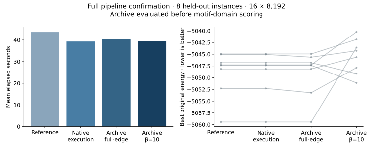

# CPU-native experimental evaluation

The CPU-native execution path improves throughput while preserving the
reference candidates. At 16 replicas × 8,192 sweeps, eight held-out instances
give a **1.122× median paired execution speedup**. A separate original-objective
archive preserves earlier useful states; exact motif scoring reduces its cost.
This report separates execution, candidate selection, and parameter experiments.

The [numbered findings log](FINDINGS.md) gives each implementation change,
operating decision, and source investigation a stable reference. This report
retains the full measurement setup and study tables.

## Hardware, model, and measurement

| Item | Evaluated setting |
|---|---|
| CPU | AMD EPYC 7663 exposed as six x86_64 KVM vCPUs |
| Experiment placement | Two concurrent single-core benchmark processes, pinned to CPUs 3 and 4 at nice level 10 |
| Live miner allocation | CPUs 0 and 1, two lease workers, 1 GiB service memory cap |
| Toolchain | Rust 1.97.1, Cargo release profile, locked dependencies |
| Solver contract | quip-solver-core / protocol / conformance 0.0.15, solver protocol 2 |
| Family | `quip/twisted-ice-dimer`, revision 1 |
| Chain snapshot | Runtime spec 121, weak magnitude 45, 1,350 pairs |
| Canonical graph | 4,560 nodes, 41,205 edges |
| Search | Weak scale 1.5, integer weak magnitude 67; tile and pair auxiliary weights 250 milli |
| Population | 16 replicas; 512 configured resampling checkpoints; checkpoint Houdayer moves |
| Temperature | Geometric β=1 to β=12, unless a study explicitly varies the endpoint |
| Final polish | Original coefficients, greedy descent, β=20 for 256 cluster-plus-Metropolis sweeps on up to four regular candidates, final greedy descent; archive candidate refined separately |

The topology hash is
`0x2d130ce6df0fceacff26b90a06811829707bde8227d45e04ef71c804a8a5345c`.
[Topology](../../tools/cpu-funnel/inputs/current-topology.spec.json) and
[family descriptor bytes](../../tools/cpu-funnel/inputs/current-family.params)
are committed with the harness. Each offline nonce is `BLAKE3(seed.to_le_bytes())`;
the canonical generator constructs the instance from that nonce. The RNG seed
is the instance seed XOR `0x43505542454e4348`. No network submission is involved.

Kernel timing begins after instance generation and prepared-graph construction.
Pipeline timing begins at solver orchestration and includes graph preparation,
annealing, candidate handling, polishing, and canonical rescoring. Process
startup and canonical instance generation are outside both timers. Paired ratios
divide reference elapsed time by variant elapsed time. The two CPU assignments
alternate by instance. Times therefore measure the reported offline workload,
not the explorer's self-reported `device_access_time_us` field.

Energy tables use **energy units**, equal to `energy_milli / 1000`; lower is
better. Integer differences labeled milli units are reported without conversion.
All output energies include the canonical family offset.

## Profile-guided execution study

The baseline profile collected 3,215 user-space cycle samples with no lost
samples. The [aggregate profile](data/baseline-profile.txt) attributes approximately
66.5% to cluster sweeps, 14.8% to union-find joins, 9.1% to Metropolis sweeps,
3.14% to field reset, and 1.85% to `exp`. This identifies field movement and
component construction as substantial CPU costs; it does not establish the
speedup of any proposed optimization by itself.

The [ablation data](data/ablation-study/results.json) cover seeds 1001–1008,
16 replicas × 2,048 sweeps, and five independently selected variants. Each
variant is paired with a fresh scalar-reference run on the same instance:
**40 pairs / 80 runs**.

| Execution setting | Median paired speedup | Observed pair range | Output matches |
|---|---:|---:|---:|
| Shared probability table | 1.033× | 0.976–1.206× | 8/8 |
| Parent spin and field transfer | 1.094× | 0.866–1.205× | 8/8 |
| Inlined monotone union-find | 1.028× | 0.867–1.194× | 8/8 |
| Packed adjacency fusion | 0.978× | 0.872–1.115× | 8/8 |
| All four execution options | **1.264×** | 1.112–1.361× | **8/8** |


Fusion alone has a small median slowdown in this study. The combined path
improves every paired run. The options interact through cache occupancy,
memory traffic, and hot-loop layout, so their independent ratios are not
additive or multiplicative. The release configuration is supported by the
combined comparison and the full-budget confirmation below.

Operation counters corroborate what the code changes. At this budget, field
transfer reduces field rebuilds from 8,192 to 16 and performs 8,176 exact parent
field copies, avoiding 673,784,160 coefficient visits. The shared probability
arrays consume 294,936 bytes at the default capacity. In seed 1008's combined
run, counters record 26,311,626 heat-bath hits and 145,721,441 Metropolis hits,
with explicit misses and fallbacks retained in the raw record.

The harness field `trajectory_digest` hashes **returned candidate spins and
their original energies in order**. Equality proves exact output agreement
for the benchmark; per-sweep spin and energy equivalence is established by
the mechanical tests described below.

## Full-budget held-out confirmation

The [confirmation data](data/confirmation/results.json) use seeds 1021–1028,
which were excluded from the temperature pilot, at **16 × 8,192**. The scalar
reference uses the same population schedule, canonical instance, weak bias,
and polishing procedure with the four native execution options disabled.
Native execution enables those four options. The archive setting additionally
retains original-objective record states. This experiment preceded motif-domain
scoring and uses full-edge archive evaluation.

| Setting | Mean elapsed time | Mean best original energy | Best observed energy |
|---|---:|---:|---:|
| Scalar reference, β=12 | 43.649 s | −5048.9200 | −5059.455 |
| Native execution, β=12 | 39.293 s | −5048.9200 | −5059.455 |
| Native execution + archive, β=12 | 40.297 s | **−5049.1075** | −5059.455 |
| Native execution + archive, β=10 | 39.511 s | −5045.4613 | −5051.115 |

The median reference/native execution ratio is **1.122221×**, with a paired
bootstrap 95% median interval of **1.103708–1.140505×**. Candidate output digests
match in all eight pairs. The [summary](data/confirmation/summary.json) retains
the unrounded numbers. The bootstrap resamples instance ratios; it describes
this instance set and environment rather than performance across CPU models.



The archive improves seeds 1022 and 1027 by **580 and 920 milli units**
(0.580 and 0.920 energy units), respectively. It preserves the reference best
on the other six instances. Mean improvement is 187.5 milli units. The regular
path receives its original random sequence before the independent archive
candidate is polished, supporting the tested best-candidate non-regression
invariant. Archive preservation is an additional candidate-handling stage,
so its timing and quality are reported separately from execution-only speedup.

## Exact motif-domain archive scoring

For uniform weak magnitudes, the search energy and physical strong motifs
determine original energy exactly. The conversion replaces repeated full-edge
archive scans while leaving final canonical proof scoring intact. See the
[derivation and fallback guards](TECHNICAL_REPORT.md#motif-domain-original-energy-conversion).

The [motif comparison](data/motif-confirmation/results.json) contains eight
paired full-pipeline runs at 16 × 8,192 on seeds 1021–1028. It compares the
frozen full-edge-scoring benchmark with the motif implementation, alternating
CPU assignments.

| Archive scorer | Mean pipeline elapsed time | Output matches |
|---|---:|---:|
| Full original edge scan | 42.321 s | 8/8 |
| Exact motif-domain conversion | **39.388 s** | **8/8** |

The median paired ratio is **1.085200×**. The timing is for the complete
archive-enabled pipeline, not an isolated scorer microbenchmark. All returned
candidate digests match. The [build record](data/confirmation/build.json)
identifies the frozen pre-conversion executable by SHA-256. The public runner
reproduces the comparison using one current executable with the motif option
enabled or disabled; a final parity smoke run verifies that switch.


This experiment occurred separately from execution confirmation. Its mean
times are not paired with the earlier scalar-reference times, and the two
reported speedups are not multiplied into a combined claim.

## Temperature selection and confirmation

The [temperature pilot](data/temperature-study/results.json) tests β endpoints
8, 10, 12, 16, 18, and 24 on six instances, seeds 1011–1016, at 16 × 2,048.
Every run uses native execution with the archive disabled and polish β=20.

| Endpoint β | Mean best original energy | Mean elapsed time |
|---:|---:|---:|
| 8 | −5028.4133 | 11.255 s |
| 10 | **−5034.6467** | 10.587 s |
| 12 | −5026.4033 | 10.088 s |
| 16 | −5030.0967 | 9.892 s |
| 18 | −5028.4700 | 9.941 s |
| 24 | −5026.5333 | 9.175 s |


The pilot suggested β=10, but the held-out full-budget archive runs gave
mean energy −5045.4613 at β=10 versus −5049.1075 at β=12. The release therefore
retains **β=12 and polish β=20**. Changing sweep budget and archive handling
changes the operating regime; the pilot establishes a candidate setting and
the confirmation decides whether to deploy it.

An additional [two-instance colder pilot](data/thermal-pilot/results.json)
tested endpoints 48 and 64, with polish β=20 or 80. Those settings produced
shallower mean energies than the β=12 / polish β=20 reference on that small
set. The parameters remain available for future recipe-specific experiments.

## Storage and resampling pilots

Five comparisons use the native kernel at 16 replicas × 2,048 sweeps on
seeds 1031–1038. Both processes use the `core` preset with an 8,192-slot cache.
CPU assignments alternate on cores 3 and 4. Each variant had a fresh reference
run for each seed. [Findings C31–C34](FINDINGS.md#c31).

| Candidate | Median speed ratio | Paired bootstrap 95% median interval | Matches |
|---|---:|---:|---:|
| [32-bit fields](data/storage-resampling/fields32/summary.json) | 0.964× | 0.927–1.019× | 8/8 |
| [16-bit cache stamps](data/storage-resampling/stamps16/summary.json) | 0.962× | 0.872–1.004× | 8/8 |
| [Selective resampling](data/storage-resampling/selective/summary.json) | 1.010× | 0.979–1.105× | 8/8 |
| [Both storage changes](data/storage-resampling/compact/summary.json) | 0.974× | 0.846–1.136× | 8/8 |
| [Both storage changes and selective resampling](data/storage-resampling/combined/summary.json) | 1.021× | 0.941–1.143× | 8/8 |

The two storage changes together saved 632,836 bytes across the live fields,
resampling snapshots, and probability arrays of one 16-replica solve. These
are allocated array payloads. Selective resampling reduces the copies made at
each checkpoint while retaining the same reserved snapshot capacity. The
pilot supports the payload and copy-count reductions. Its timing intervals
all span 1.0×.

The [source manifest](data/storage-resampling/source-sha256.json) records the
build inputs captured during the pilot. The listed files match commit
[`36519c0`](https://github.com/NSEVEjk0/quip-solver-cpu/commit/36519c0bedb029d82246336f9a151559a5eafccb).
The run metadata records the Git HEAD and working-tree status at measurement
time. Build feature flags and executable hashes identify each comparison.

## Cluster-boundary field updates

The candidate adds `cluster-boundary-updates` to the locked release build.
Each run uses the existing native execution options. The pilot times the
population kernel. The full-budget comparison includes graph preparation,
the original-energy archive, motif-domain scoring, and polishing.

| Comparison | Seeds | Replicas × sweeps | Mean reference / candidate | Median ratio | Paired bootstrap 95% median interval | Matches |
|---|---:|---:|---:|---:|---:|---:|
| [Kernel pilot](data/cluster-boundary/pilot-boundary/results.json) | 1041–1048 | 16 × 2,048 | 10.255 / 9.010 s | 1.129× | 1.069–1.147× | 8/8 |
| [Full pipeline](data/cluster-boundary/confirm-boundary/results.json) | 1051–1058 | 16 × 8,192 | 36.597 / 36.475 s | 0.996× | 0.976–1.088× | 8/8 |

In the pilot, 3.87–4.36% of the accepted-component adjacency visits were
interior edges. The candidate skips 3.18–3.55 million interior neighbor
patches per run and adds 5.45–5.59 million field transformations. Measured
full-pipeline performance is near parity, with exact output agreement.
The feature is off by default. [Derivation](TECHNICAL_REPORT.md#c35-cluster-boundary-field-updates),
[binary and source hashes](data/cluster-boundary/build.json).

## Packed component labels and spin signs

The `packed-component-spins` feature reuses the completed union-find buffer
to store a component ID and one sign bit per node. Both studies use the
`core` preset, 16 replicas × 2,048 sweeps, and the native comparison build
with ordinary field and stamp widths. Each pair returns the same candidate
spins and original energies.

| Comparison | Seeds | Median speed ratio | Paired bootstrap 95% median interval | Matches |
|---|---:|---:|---:|---:|
| [Initial kernel pilot](data/packed-component-spins/pilot-packed/results.json) | 1061–1068 | 1.124× | 0.826–1.231× | 8/8 |
| [Kernel with hardware counters](data/packed-component-spins/perf-packed/results.json) | 1071–1078 | 0.939× | 0.892–0.990× | 8/8 |

In the instrumented pairs, the median candidate retired 4.9% more
instructions and used 4.5% more process CPU time. Perf counts cover the
whole benchmark process, including preparation and verification outside
the harness timer. The total instruction count establishes an increase
for this build, without attributing it to individual operations.
[Counter summary](data/packed-component-spins/perf-packed/summary.json).

## Row-grouped residual energy scan

With `row-grouped-residual-deltas`, a lazy compressed adjacency stores each
residual edge once, from the lower endpoint. The scan uses one spin and
component lookup for the head of each row and one component-delta update for
its subtotal. Additions use 64-bit integers and retain the reference
component draw order. The row-grouped scan takes precedence if the two
residual layout features are built together.

| Comparison | Seeds | Replicas × sweeps | Median speed ratio | Paired bootstrap 95% median interval | Matches |
|---|---:|---:|---:|---:|---:|
| [Kernel](data/residual-edge-scan/pilot-row/results.json) | 1081–1088 | 16 × 2,048 | 1.066× | 0.885–1.228× | 8/8 |
| [Full pipeline](data/residual-edge-scan/confirm-row/results.json) | 1091–1098 | 16 × 8,192 | 0.997× | 0.900–1.036× | 8/8 |

In the full pipeline, the median changes in whole-process counters were
**−10.6% instructions, +20.0% branch misses, and +3.7% cycles**. The retired
instruction count fell on every seed. The elapsed-time interval spans parity,
so the feature remains experimental. [Full-pipeline counter summary](data/residual-edge-scan/confirm-row/summary.json).

### Mask the interior-edge term

The `masked-residual-deltas` build keeps the grouped layout and adds the
edge term after masking it by component membership. Same-component edges
add zero. This tests whether removing the branch helps even though the
loop performs arithmetic and a delta update for every edge.

The [kernel pilot](data/residual-edge-scan/pilot-masked/results.json) compares
the two row-grouped builds at 16 × 2,048 on seeds 1101–1108. All eight output
digests matched. The median speed ratio was 1.129×, with a paired bootstrap
95% median interval of 0.985–1.250×. The masked build recorded 41.1% fewer
branch misses and 6.8% fewer cycles, with 12.4% more retired instructions at
the median. [Counter summary](data/residual-edge-scan/pilot-masked/summary.json).

The [full-pipeline comparison](data/residual-edge-scan/confirm-masked/results.json)
uses the existing native build as the reference and the archive preset in both
arms. At 16 × 8,192 on seeds 1111–1118, mean elapsed time was 40.899 s for the
reference and 39.344 s for the masked build. The median speed ratio was
**1.028×**, with a paired bootstrap 95% median interval of **1.006–1.061×**.
Seven of eight pairs ran faster, and all eight candidate digests matched.

Whole-process median counts showed 28.8% fewer branch misses, 5.1% fewer cycles,
and 3.1% more retired instructions. Cycle and branch-miss counts fell in every
pair. The measurements cover the specified recipe and one EPYC 7663 VPS. The
masked path is an opt-in build. [Counter summary](data/residual-edge-scan/confirm-masked/summary.json),
[build and hashes](data/residual-edge-scan/masked-build.json).

## Correctness and protocol checks

The release validation checks the actual native binary and its family adapter:

- All flag combinations for the four execution options and selective
  resampling are compared with scalar population outputs across seeds,
  schedules, and bond weights.
- Move-level tests compare cluster and Metropolis spin states and exact
  energy changes with the scalar path; tiny-model tests independently score
  every state and check cluster transition distributions.
- Canonical family generation and full original-energy scoring are compared
  with the contract generator, including random-state motif conversions at
  multiple weak bias scales and scalar/motif archive output equality.
- Archive non-regression, malformed descriptors, cancellation during sampling,
  expired deadlines, stale leases, digest mismatches, and balanced credit
  accounting are covered by the family library and session conformance suites.
- Formatting and Clippy checks complete with warnings denied for the changed
  library, native binary, benchmark example, and integration tests.

The [operator guide](OPERATOR_GUIDE.md#checks-and-operation) provides standard
Cargo commands. The final test logs and command records are in `data/validation/`.
For the masked build, 23 kernel tests and one native session conformance test
passed. With the storage, cluster, and residual-scan features selected together,
32 family-library tests, Clippy with warnings denied, and formatting passed.
See the [validation record](data/residual-edge-scan/masked-validation.json).
Native deployment observations are recorded separately in
[live operation](LIVE_OPERATION.md); coordinator candidate validation is a
different event from inclusion of a winning proof in a block.

## Reproduction and evaluation scope

Build the locked release example and run the [portable study runner](../../tools/cpu-native/run_study.py):

```sh
cargo build --release --locked --features experimental --bin quip-cpu-native --example cpu_native_bench -j 2
python3 tools/cpu-native/run_study.py --suite ablation --cpus 3 4 --output /tmp/quip-ablation
python3 tools/cpu-native/run_study.py --suite confirmation --cpus 3 4 --output /tmp/quip-confirmation
python3 tools/cpu-native/run_study.py --suite motif --cpus 3 4 --output /tmp/quip-motif
python3 tools/cpu-native/run_study.py --suite temperature --cpus 3 4 --output /tmp/quip-temperature
```

Choose CPU IDs available on the evaluation host. The runner records source,
executable and input hashes, placement, full commands, original energies,
candidate digests, individual results, and paired summaries. Historical raw
commands preserve the original VPS paths; the public runner resolves paths
relative to its checkout. Kernel and pipeline budgets remain independently
selectable. `--disable-motif-score` reproduces scalar archive evaluation.

To reproduce the storage pilots, save the reference executable before building
each feature variant. Selective resampling uses the same binary in both arms
when comparing it on its own.

```sh
study=$(mktemp -d)
cargo build --release --locked --features experimental --example cpu_native_bench -j 2
cp target/release/examples/cpu_native_bench "$study/wide"
cargo build --release --locked --features experimental,compact-local-fields,compact-cache-stamps --example cpu_native_bench -j 2
cp target/release/examples/cpu_native_bench "$study/compact"
python3 tools/cpu-native/compare_builds.py --reference-binary "$study/wide" --candidate-binary "$study/compact" --label combined --selective-resampling --cpus 3 4 --output "$study/combined"
```

Build with one storage feature at a time for the individual comparisons. Use
the recorded feature and resampling settings for each arm.

For the cluster-boundary comparison, retain `"$study/wide"` from the command
above and build the alternative update:

```sh
cargo build --release --locked --features experimental,cluster-boundary-updates --example cpu_native_bench -j 2
cp target/release/examples/cpu_native_bench "$study/boundary"
python3 tools/cpu-native/compare_builds.py --reference-binary "$study/wide" --candidate-binary "$study/boundary" --label cluster-boundary --cpus 3 4 --output "$study/boundary-pilot" --seed-start 1041 --sweeps 2048 --mode kernel --preset core
python3 tools/cpu-native/compare_builds.py --reference-binary "$study/wide" --candidate-binary "$study/boundary" --label cluster-boundary-pipeline --cpus 3 4 --output "$study/boundary-pipeline" --seed-start 1051 --sweeps 8192 --mode pipeline --preset archive
```

To repeat the grouped-edge instrumented study, build with
`experimental,row-grouped-residual-deltas` and save the example as
`"$study/rows"`. The runner's `--perf` option requires Linux `perf` and access
to hardware counters. The results include per-process instructions, cycles,
branch and cache events, and task-clock milliseconds.

```sh
python3 tools/cpu-native/compare_builds.py --reference-binary "$study/wide" --candidate-binary "$study/rows" --label row-grouped-residual-deltas-pipeline --cpus 3 4 --output "$study/row-pipeline" --seed-start 1091 --sweeps 8192 --mode pipeline --preset archive --perf
```

To evaluate masking, build with `experimental,masked-residual-deltas` and
save the example as `"$study/masked"`. The feature selects the row-grouped
layout automatically. Compare it with the branching row build at the kernel
budget and the standard native build at the operational budget.

```sh
python3 tools/cpu-native/compare_builds.py --reference-binary "$study/rows" --candidate-binary "$study/masked" --label masked-residual-deltas --cpus 3 4 --output "$study/masked-kernel" --seed-start 1101 --sweeps 2048 --mode kernel --preset core --perf
python3 tools/cpu-native/compare_builds.py --reference-binary "$study/wide" --candidate-binary "$study/masked" --label masked-residual-deltas-pipeline --cpus 3 4 --output "$study/masked-pipeline" --seed-start 1111 --sweeps 8192 --mode pipeline --preset archive --perf
```

The evidence covers the specified Quip family, recipe, toolchain, and VPS.
It establishes exact CPU execution improvements and measured candidate
preservation on these instances. Validation against other recipes, bare-metal
CPUs, hardware architectures, or equal wall-time solver budgets requires its
own measurements. Network difficulty and competing proof sets vary by round;
the offline energy and timing comparisons do not determine a block-win rate.
