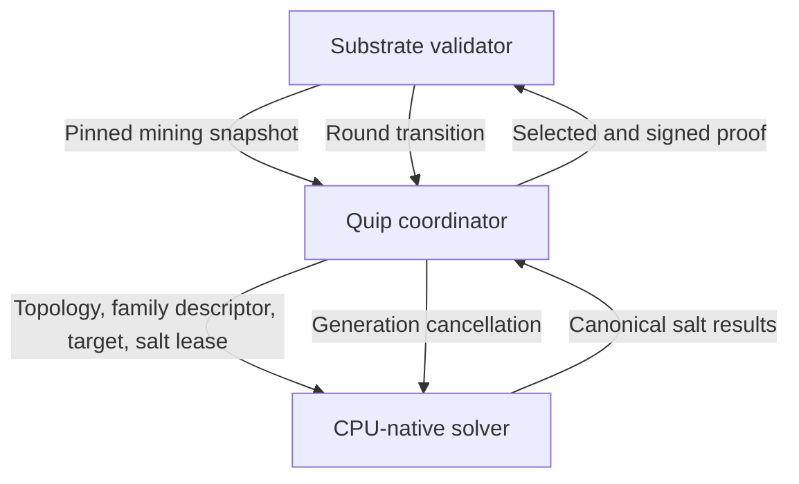

# Quip node and proof pipeline research

The CPU implementation is designed around the actual work and validation
boundaries of the Quip stack. Research covers the official coordinator,
solver contract, validator, node deployment, and benchmark tooling. The
[source index](data/source-index.json) records the pinned revisions and paths
used for the review.

## Primary source anchors

| Question | Pinned primary evidence |
|---|---|
| What selects an instance? | [Solver contract: salt replacement and BLAKE3 nonce derivation](https://github.com/QuipNetwork/quip-solver-core/blob/3a6b11ee2d58453fca535b774c40c8d25069b83b/SPEC.md#L320) |
| Can a previous-round nonce pass? | [Runtime: persisted round anchor and expected nonce check](https://github.com/QuipNetwork/quip-validator/blob/651d4a678b4152ad4bc0320615ab586a0cf88df9/pallets/quantum-pow/src/lib.rs#L1065) |
| Who determines the canonical problem? | [Runtime: registered topology and mineability](https://github.com/QuipNetwork/quip-validator/blob/651d4a678b4152ad4bc0320615ab586a0cf88df9/pallets/quantum-pow/src/lib.rs#L1050) and [family witness reconstruction](https://github.com/QuipNetwork/quip-validator/blob/651d4a678b4152ad4bc0320615ab586a0cf88df9/pallets/quantum-pow/src/lib.rs#L1512) |
| Which score and difficulty gates apply? | [Runtime: current difficulty, canonical validation, strict energy/count/diversity gates](https://github.com/QuipNetwork/quip-validator/blob/651d4a678b4152ad4bc0320615ab586a0cf88df9/pallets/quantum-pow/src/lib.rs#L1081) |
| Is device time verified by consensus? | [Runtime: device time copied into the proof record after acceptance checks](https://github.com/QuipNetwork/quip-validator/blob/651d4a678b4152ad4bc0320615ab586a0cf88df9/pallets/quantum-pow/src/lib.rs#L1123) |
| What happens when work is stale? | [Solver contract: generation cancellation and lease close rules](https://github.com/QuipNetwork/quip-solver-core/blob/3a6b11ee2d58453fca535b774c40c8d25069b83b/SPEC.md#L876) |
| How does a returned candidate become a proof? | [Coordinator: local result validation and family proof selection](https://github.com/QuipNetwork/quip-solver/blob/b60c27117ae00219c4a03a1f77c2a591bd34292f/docs/COORDINATOR.md#L468) |

The reviewed runtime derives canonical energies and reads current difficulty
validator-side. Miner timing remains observability. Salt-dependent instance
variation is therefore distinct from accepting an invalid topology, an old
round anchor, or an unverified proof energy.

## Runtime responsibilities

The validator owns consensus and canonical proof acceptance. The coordinator
is the chain client: it follows the head, reads the mining snapshot, supervises
solver processes, selects proof sets, and submits eligible proofs. The CPU
solver consumes jobs over the local solver session and returns candidates.
It needs no signing key or RPC connection.



The deployment stack separates the validator, coordinator/CPU service, and
dashboard. CPU affinity and memory limits apply to the mining service. The
reviewed operator configuration allocates two of six vCPUs and a 1 GiB
container limit to CPU mining. Solver iteration can therefore proceed without
replacing the validator or dashboard services.

## Current instance family

The evaluated chain snapshot is runtime spec 121, with family
`quip/twisted-ice-dimer` revision 1, weak magnitude 45, and 1350 pairs.
The graph has 4560 nodes and 41205 edges. Its registered topology hash is
`0x2d130ce6df0fceacff26b90a06811829707bde8227d45e04ef71c804a8a5345c`.
The complete topology and descriptor bytes accompany the benchmark inputs.

The canonical generator supplies the coupling arrays, local gauges, tiles,
pairs, and energy offset. Topology identity and native node order are part of
the binding. Solver-side execution changes operate on these admitted data;
search reweighting is internal and proof energy uses the original instance.

## Nonce and round binding

The protocol derives a 32-byte nonce as

```text
BLAKE3(last_proof_block_hash || miner_account || salt)
```

Salt leases replace the first eight salt bytes with the little-endian counter.
The remaining bytes stay fixed within that lease. The family generator uses
the resulting nonce, so different salts produce different instances on the
same registered topology. Nonce selection is consequently a search-allocation
decision, while topology and proof validation remain canonical.

The validator re-derives the nonce from the signer, salt, and persisted
`LastProofBlockHash`. This anchor changes when a new proof wins. Its persisted
cache also avoids depending on the finite historical block-hash ring buffer.
A previous-round nonce does not satisfy the current binding.

## Candidate validation and block eligibility

The runtime resolves the registered topology, checks mineability, derives the
expected nonce, regenerates or validates the canonical family problem, and
evaluates the solution set against current difficulty. The energy gate is
strict: `best_energy_milli < max_energy_milli`. Solution-count and diversity
gates are checked independently.

Returned candidates, coordinator-validated results, submitted proofs, and
included block winners are distinct events. Benchmark analysis uses exact
original-energy minima and elapsed time. Operational validation counters are
reported as coordinator counters. Block inclusion is recorded separately.
This distinction makes the measurements useful for implementation review.

## Lease lifetime and cancellation

Each admitted lease keeps its descriptor and topology snapshot. One lease
consumes one credit. Completion or a covered generation cancellation closes
the lease and returns a credit. Generation-zero jobs have no round watermark
and survive generation cancellation.

The CPU sampler bounds active workers and checks `LeaseSink::is_stopped()`
during generation, replica sweeps, and polishing. Candidate archives belong
to one lease and nonce. Covered cancellations and expiry prevent subsequent
results from being forwarded. The node observation verifies work resumed
after an actual qblock transition, alongside session conformance tests for
stale leases, deadlines, and balanced credit accounting.

## Timing and measurement

`QuantumProof.device_access_time_us` is self-reported observability; validator
consensus does not read it. The research uses host wall time and CPU profiling
counters for performance measurements. A cancellation acknowledgement is
reported as control-protocol latency, separately from kernel execution time.

The baseline profile sampled 3215 user-space cycle events without lost
samples. Approximately 66.5% of sampled time was in cluster sweeps, 14.8% in
union-find joins, 9.1% in Metropolis sweeps, and 3.1% in field reset. This
motivated adjacency fusion, union specialization, and resampling field transfer.
The table-cache design was assessed through ablations rather than inferred
from exponential-call counts alone.

## Compatibility and reproducibility

The tested solver uses CPU package v0.3.6, solver-core v0.0.15, protocol 2,
Rust 1.97.1, and the recorded coordinator image digest. The current upstream
solver documentation describes v0.0.17, including fixed-point coefficient
types and optional calibration. Those APIs were reviewed separately from the
release dependency pins; they are not claimed as implemented by this build.

Quip's coordinator `drive` mode and IsingMark both support offline evaluation.
The native kernel harness additionally isolates execution changes on identical
canonical instances, exposes operation counts, and checks trajectory digests.
The protocol smoke test uses the coordinator in a container with network
access disabled and no keystore mounted.

The benchmark records identify seed, nonce, read count, sweep count, temperature
endpoints, polishing temperature, CPU affinity, and the full command. Execution
ablations use alternating CPU assignments. Search settings use separate pilot
and confirmation instances. These controls permit reviewers to repeat the
analysis and assess the limits of the measured results.
