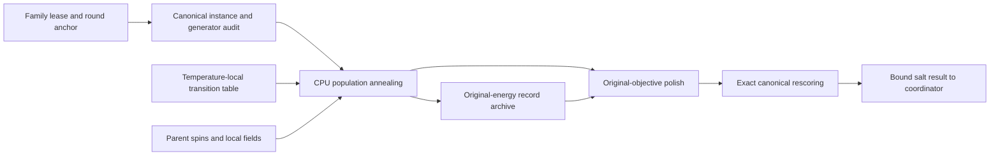

# CPU-native solver: execution design

This implementation targets the cluster-update hot path of Quip's
`quip/twisted-ice-dimer` family. The design keeps the canonical problem and
proof energy independent of the internal search model, and makes execution
optimizations independently selectable for controlled evaluation.

## Model and execution

For binary spins, the canonical energy in milli units is

```math
E(s)=\sum_u h_u s_u+\sum_{(u,v)}J_{uv}s_us_v+E_{offset}.
```

The evaluated family has zero fields. Its strong tile and pair couplings
have magnitude 1000; the current weak layer has magnitude 45. Local gauges
and pair membership come from canonical instance metadata. Each coupling
is split into a part handled by the auxiliary-bond draw and a residual part
scored by the component heat bath. This split changes the transition
construction, while the model energy retains the complete coupling.

The search can bias weak couplings internally. At scale 1.5, the current
integer weak coefficient is 67. Every returned candidate is scored again
with the original coefficient 45 and the canonical offset. A search score
is therefore never substituted for a proof score.



<a id="packed-adjacency-fusion"></a>
## C01. Packed adjacency fusion

A cluster flip previously traversed residual adjacency to update neighboring
component deltas, then full adjacency to patch local fields. The fused path
stores the neighbor and both coefficients in one 64-bit entry: 21 bits for
the node position and 11 bits for each biased signed coefficient. Rows are
constructed once per prepared graph and retained behind `OnceLock`.

For a flipped node `u`, the combined pass performs

```math
f_v \leftarrow f_v-2s_uJ_{uv},\qquad
\Delta_{c(v)}\leftarrow\Delta_{c(v)}+4J^{res}_{uv}s_us_v
```

where the second update applies only across a component boundary and for a
nonzero residual coupling. The node's full-model energy change is
`-2 * s_u * f_u`. No self-loop is admitted, so this value is identical before
and after patching its neighbors. Fields and component deltas occupy separate
arrays; interleaving these integer updates preserves their values at each
component boundary. The component draw order remains unchanged.

<a id="monotone-union-find-inlining"></a>
## C02. Monotone union-find inlining

Component roots remain the smallest node in their component. Path halving
and joining the larger root beneath the smaller preserve `parent[u] <= u`,
which permits deterministic dense component numbering in one node-order pass.
The native path specializes and inlines this operation inside the bond draw.
It preserves the original tree operations and random draws. The scalar
implementation remains available for direct comparison.

<a id="temperature-local-probability-reuse"></a>
## C03. Temperature-local probability reuse

Replica moves at a shared temperature repeatedly evaluate the same integer
energy changes. A bounded, collision-free table stores heat-bath and
Metropolis probabilities indexed by half the energy change. Signed entries
cover heat-bath moves; positive entries serve Metropolis updates.

Epoch tags invalidate probabilities when the temperature changes without
clearing the table. A tag wrap clears both stamp arrays. Out-of-range or odd
energy changes use the scalar expressions. Bond-breakup probabilities are
also shared across replicas. The implementation retains the original
floating-point expression order for each probability, including the separate
positive and negative heat-bath branches. It does not approximate exponentials
or alter the number of random draws.

The default 8192-slot capacity uses 294936 bytes for probability and stamp
arrays. Capacity is bounded independently of graph size. Diagnostics expose
hits, misses, fallbacks, temperature changes, and allocated bytes.

<a id="exact-local-field-transfer-at-resampling"></a>
## C04. Exact local-field transfer at resampling

The local field `f_u = sum_v J_uv * s_v` is already maintained incrementally
by every accepted flip. A resampled child copies an existing parent state
on the same immutable graph. Recomputing these fields from adjacency is
unnecessary: the parent spins and their exact fields can be copied together.

A fixed-size snapshot captures all parents before any child is overwritten.
This handles repeated parents and ancestry cycles. The snapshot is reused
at every checkpoint. Component labels and bond workspaces remain transient
and are rebuilt by the next cluster draw. Energy histories continue to follow
the original resampling picks.

At `R` replicas and `N` nodes, snapshot storage is `9RN` bytes. A checkpoint
copies `18RN` bytes instead of rebuilding fields through `2RM` adjacency
entries. Operation counters record copied fields and coefficient visits avoided.

<a id="original-objective-candidate-preservation"></a>
## C05. Original-objective candidate preservation

Population resampling can remove a useful historical state when its present
ancestor is not selected. Internal weak bias also makes the search objective
different from the proof objective. The archive evaluates original energy
at replica record improvements, including cluster states before the following
Metropolis sweep, and retains the best observed candidate independently of
ancestry. Consecutive identical states reuse their exact score.

The regular retained samples are polished first with their existing random
sequence. A distinct archived candidate receives independent polishing and
is merged afterward. All candidates are rescored against the canonical
instance; the result set is bounded to the requested read count. This preserves
the best result of the regular path while allowing an earlier original-energy
candidate to survive population replacement.

The archive observes record-improvement states rather than every intermediate
spin flip. Its evaluation cost and energy benefit are measured separately from
the execution changes.

<a id="motif-domain-original-energy-conversion"></a>
## C06. Motif-domain original-energy conversion

The evaluated family has a uniform weak magnitude. Let `S` be the energy
of physical strong couplings and `W` the signed sum of weak spin products.
For search magnitude `b` and original magnitude `w`, the energies satisfy
`E_search = S + bW` and `E_original = S + wW`.

```math
E_{original}=S+w\frac{E_{search}-S}{b}.
```

The search energy is maintained by the kernel. The physical strong energy
is evaluated from four-spin tile charges and pair products, independently
of auxiliary draw weights. This replaces a full edge scan at an archive
record with a motif scan. The integer division is exact for a uniform weak
layer. Admission checks the weak magnitudes; nonuniform cases and failed
divisibility checks use the complete original-model scorer.

Random-state tests compare this conversion with full canonical rescoring
across several bias scales and instances. Every emitted proof candidate
still receives the independent full canonical score, including its offset.

## C35. Cluster-boundary field updates

For an accepted component `C`, let `f_u` be the current full local field of
node `u`, and let `f_out(u)` be the contribution from neighbors outside `C`.
After flipping the component, the inside contribution changes sign and the
outside contribution stays fixed during the move. For `u` in `C`,

```math
f'_u=-f_u+2f_{\mathrm{out}}(u),\qquad
\Delta E=-2\sum_{u\in C}s_u f_{\mathrm{out}}(u).
```

The fused pass visits every neighbor of an accepted component member. It
skips field patches through interior edges, transforms each member field
once, and applies the usual field and residual-delta patches to outside
neighbors. Component decisions and their random draws still follow the same
order. The arithmetic uses a 64-bit intermediate so it also works with the
32-bit field representation.

The experiment counts skipped interior patches, boundary patches, and member
field transformations. The [paired study](EXPERIMENTS.md#cluster-boundary-field-updates)
measures their net effect on elapsed time. Enable the research path at build
time with `cluster-boundary-updates` and use the fused update preset.

## Temperature and polish studies

The geometric ladder and final original-objective polish have separate
temperature controls. A weak-normalized endpoint uses
`beta_end = theta * 1000 / abs(J_weak_search)`; explicit job temperature ranges
take precedence. The current internal magnitude is 67, while canonical
polishing uses magnitude 45. Temperature endpoints and polish temperature
are evaluated on identical instances at fixed read and sweep budgets.

The study tests both the existing operating range and colder alternatives.
Measured operating points determine the release configuration. The complete
parameter record and command for each run accompany the results.

## Mechanical validation

The population tests exercise all flag combinations for cache, field transfer,
union inlining, adjacency fusion, and selective resampling. Tests vary bond
weights, temperatures, seeds, and resampling cadence. Per-move checks compare
the spin state, energy change, and final RNG position with the scalar path.
Canonical family tests independently rescore proof energy and check archive
non-regression.

The runtime additionally audits cached coupling generation every 64 salts
and for every solved survivor. Cancellation is checked during generation,
every replica sweep, and polishing. Candidate archives are local to one
instance and lease.

See [experiments](EXPERIMENTS.md), [node integration](NODE_RESEARCH.md), and
[source provenance](../../ACKNOWLEDGMENTS.md).
